<picture>
  <source media="(prefers-color-scheme: dark)" srcset=".github/assets/header-dunkel.svg">
  
</picture>

   

<h3 align="center">Your AI forgets you every morning. These repos fix that.</h3>

Hand-picked open-source building blocks for your own **personal AI operating system**: one brain, many agents, clear rules. Picked from 6,600+ starred repos and sorted by the job they do in the stack, not by hype.

## Start here

No time for 87 repos? These 4 cover the whole loop. Add the rest when you feel the gap.

| Role | Pick | Why |
|:--|:--|:--|
| **Builder** | [claude-code](https://github.com/anthropics/claude-code) `★ 153.8k` | writes and ships the code for everything else |
| **Companion** | [hermes-agent](https://github.com/NousResearch/hermes-agent) `★ 258.1k` | lives on your machine and answers on chat |
| **Hands** | [servers](https://github.com/modelcontextprotocol/servers) `★ 91.6k` | connects agents to files, apps and APIs |
| **Pipes** | [n8n](https://github.com/n8n-io/n8n) `★ 208.9k` | runs the routine so agents keep the thinking |

<picture>
  <source media="(prefers-color-scheme: dark)" srcset=".github/assets/map-dunkel.svg">
  
</picture>

## Contents

- [Agents that live with you](#agents-that-live-with-you) · 7
- [Coding agents](#coding-agents) · 9
- [Cockpits and control planes](#cockpits-and-control-planes) · 9
- [Skills and playbooks](#skills-and-playbooks) · 9
- [Tools and MCP](#tools-and-mcp) · 10
- [Memory and second brain](#memory-and-second-brain) · 10
- [Models and runtimes](#models-and-runtimes) · 7
- [Automation and pipelines](#automation-and-pipelines) · 8
- [Web, browser and data](#web-browser-and-data) · 7
- [Home, body and devices](#home-body-and-devices) · 5
- [Guardrails and security](#guardrails-and-security) · 6

## Agents that live with you

The always-on agents you talk to on chat, phone and desktop.

- **[hermes-agent](https://github.com/NousResearch/hermes-agent)** `★ 258.1k` · Self-improving personal agent with memory, skills and 20+ chat channels.
- **[openclaw](https://github.com/openclaw/openclaw)** `★ 393.3k` · The agent that really does things, on any OS and platform.
- **[nanobot](https://github.com/HKUDS/nanobot)** `★ 49.6k` · Ultra-light personal agent framework with web UI, memory and MCP.
- **[gbrain](https://github.com/garrytan/gbrain)** `★ 31.3k` · An opinionated brain for OpenClaw and Hermes agents.
- **[NemoClaw](https://github.com/NVIDIA/NemoClaw)** `★ 22.9k` · Run Hermes, OpenClaw and friends inside a secured sandbox.
- **[AstrBot](https://github.com/AstrBotDevs/AstrBot)** `★ 44.5k` · Agent assistant that plugs into many messengers and models.
- **[airi](https://github.com/moeru-ai/airi)** `★ 50.9k` · Self-hosted companion with voice, memory and a face you can talk to.

<a href="#contents">back to contents</a>

## Coding agents

Agents that read, write and ship code with you.

- **[claude-code](https://github.com/anthropics/claude-code)** `★ 153.8k` · Anthropic's agentic coding tool in the terminal.
- **[codex](https://github.com/openai/codex)** `★ 131.4k` · OpenAI's coding agent that runs locally.
- **[opencode](https://github.com/anomalyco/opencode)** `★ 222.8k` · Open-source coding agent for the terminal, any model.
- **[cline](https://github.com/cline/cline)** `★ 71k` · Autonomous coding agent inside your editor.
- **[gemini-cli](https://github.com/google-gemini/gemini-cli)** `★ 108.6k` · Gemini as an agent in your terminal.
- **[pi](https://github.com/earendil-works/pi)** `★ 118.5k` · A minimal, hackable coding agent harness.
- **[OpenHands](https://github.com/OpenHands/OpenHands)** `★ 92.1k` · Open platform for agents that write, run and fix code in a sandbox.
- **[aider](https://github.com/Aider-AI/aider)** `★ 49.8k` · Pair programming in the terminal, with git commits for every change.
- **[goose](https://github.com/aaif-goose/goose)** `★ 55.9k` · Extensible local agent that installs, runs, edits and tests on its own.

<a href="#contents">back to contents</a>

## Cockpits and control planes

Where you see what your agents do and step in.

- **[mission-control](https://github.com/builderz-labs/mission-control)** `★ 6.4k` · Mission control dashboard for agent fleets.
- **[orca](https://github.com/stablyai/orca)** `★ 109.1k` · Run a fleet of parallel coding agents with your own subscriptions.
- **[AionUi](https://github.com/iOfficeAI/AionUi)** `★ 33.9k` · 24/7 cowork app for Claude Code, Codex, OpenClaw, Hermes and more.
- **[cc-switch](https://github.com/farion1231/cc-switch)** `★ 149.7k` · Switch providers and configs across Claude Code, Codex and more.
- **[hermes-webui](https://github.com/nesquena/hermes-webui)** `★ 19.2k` · Use Hermes from the browser or your phone.
- **[claudecodeui](https://github.com/siteboon/claudecodeui)** `★ 14.3k` · Claude Code, Codex and others on mobile and web.
- **[claude-code-router](https://github.com/musistudio/claude-code-router)** `★ 37.9k` · Route agents across models and providers.
- **[paperclip](https://github.com/paperclipai/paperclip)** `★ 108.3k` · Orchestrate a whole company of agents with goals and budgets.
- **[anything-llm](https://github.com/Mintplex-Labs/anything-llm)** `★ 67.7k` · One private workspace for chats, documents, agents and local models.

<a href="#contents">back to contents</a>

## Skills and playbooks

Teach agents how to do a job once, reuse it forever.

- **[skills](https://github.com/anthropics/skills)** `★ 184.5k` · The official Agent Skills repository.
- **[superpowers](https://github.com/obra/superpowers)** `★ 307.5k` · A battle-tested skill library and workflow for coding agents.
- **[agent-skills](https://github.com/addyosmani/agent-skills)** `★ 111.5k` · Production-grade engineering skills for coding agents.
- **[obsidian-skills](https://github.com/kepano/obsidian-skills)** `★ 50.3k` · Teach your agent Obsidian, Markdown, Bases and Canvas.
- **[skills](https://github.com/mattpocock/skills)** `★ 305.8k` · Practical skills for TypeScript-heavy work.
- **[awesome-claude-skills](https://github.com/ComposioHQ/awesome-claude-skills)** `★ 78.2k` · A curated list of Claude skills.
- **[awesome-claude-code](https://github.com/hesreallyhim/awesome-claude-code)** `★ 56.8k` · Commands, hooks and workflows for Claude Code.
- **[gstack](https://github.com/garrytan/gstack)** `★ 138.1k` · An opinionated Claude Code setup with roles from CEO to QA.
- **[caveman](https://github.com/JuliusBrussee/caveman)** `★ 115.8k` · A skill that makes coding agents answer in far fewer tokens.

<a href="#contents">back to contents</a>

## Tools and MCP

Give agents hands: apps, browsers, files and APIs.

- **[servers](https://github.com/modelcontextprotocol/servers)** `★ 91.6k` · Reference MCP servers.
- **[fastmcp](https://github.com/PrefectHQ/fastmcp)** `★ 28.2k` · The fast, Pythonic way to build MCP servers.
- **[github-mcp-server](https://github.com/github/github-mcp-server)** `★ 34k` · GitHub's official MCP server.
- **[playwright-mcp](https://github.com/microsoft/playwright-mcp)** `★ 38.8k` · Browser automation for agents over MCP.
- **[serena](https://github.com/oraios/serena)** `★ 30.8k` · Semantic code retrieval and editing as an MCP toolkit.
- **[composio](https://github.com/ComposioHQ/composio)** `★ 30.8k` · Hundreds of app integrations for agents.
- **[context7](https://github.com/upstash/context7)** `★ 63.9k` · Up-to-date library docs for coding agents.
- **[awesome-mcp-servers](https://github.com/punkpeye/awesome-mcp-servers)** `★ 97k` · The big list of MCP servers.
- **[chrome-devtools-mcp](https://github.com/ChromeDevTools/chrome-devtools-mcp)** `★ 54.4k` · Lets coding agents inspect, debug and measure a live Chrome.
- **[rtk](https://github.com/rtk-ai/rtk)** `★ 84.9k` · CLI proxy that cuts the tokens agents spend on dev commands.

<a href="#contents">back to contents</a>

## Memory and second brain

So your agents stop asking the same questions.

- **[mem0](https://github.com/mem0ai/mem0)** `★ 68k` · Universal memory layer for AI agents.
- **[claude-mem](https://github.com/thedotmack/claude-mem)** `★ 104k` · Persistent memory across Claude Code sessions.
- **[khoj](https://github.com/khoj-ai/khoj)** `★ 37.9k` · Self-hostable AI second brain.
- **[logseq](https://github.com/logseq/logseq)** `★ 45.4k` · Local-first knowledge graph and outliner.
- **[LightRAG](https://github.com/HKUDS/LightRAG)** `★ 40.4k` · Simple and fast graph-based retrieval.
- **[graphrag](https://github.com/microsoft/graphrag)** `★ 36.5k` · Graph-based RAG over your own documents.
- **[mempalace](https://github.com/MemPalace/mempalace)** `★ 59.8k` · Long-term memory palace for agents.
- **[qmd](https://github.com/tobi/qmd)** `★ 30.7k` · Local search engine for your Markdown notes.
- **[hindsight](https://github.com/vectorize-io/hindsight)** `★ 55.5k` · Agent memory that learns from what happened, not only what was said.
- **[ragflow](https://github.com/infiniflow/ragflow)** `★ 93k` · RAG engine that reads messy documents and cites its sources.

<a href="#contents">back to contents</a>

## Models and runtimes

Run models locally or route between providers.

- **[ollama](https://github.com/ollama/ollama)** `★ 185.1k` · Run open models locally with one command.
- **[whisper.cpp](https://github.com/ggml-org/whisper.cpp)** `★ 54.7k` · Fast local speech-to-text.
- **[litellm](https://github.com/BerriAI/litellm)** `★ 62.3k` · One API for 100+ model providers, with budgets.
- **[vllm](https://github.com/vllm-project/vllm)** `★ 95.8k` · High-throughput model serving.
- **[LocalAI](https://github.com/mudler/LocalAI)** `★ 50k` · Drop-in local replacement for the OpenAI API.
- **[unsloth](https://github.com/unslothai/unsloth)** `★ 78.7k` · Fine-tune open models faster with less memory.
- **[llama.cpp](https://github.com/ggml-org/llama.cpp)** `★ 132.7k` · The engine under most local models: fast inference in plain C/C++.

<a href="#contents">back to contents</a>

## Automation and pipelines

Deterministic workflows for the routine, agents for the thinking.

- **[n8n](https://github.com/n8n-io/n8n)** `★ 208.9k` · Workflow automation with native AI nodes, self-hostable.
- **[activepieces](https://github.com/activepieces/activepieces)** `★ 25.3k` · Open-source automation with MCP support.
- **[dify](https://github.com/langgenius/dify)** `★ 159.9k` · Build and run agentic workflows visually.
- **[langflow](https://github.com/langflow-ai/langflow)** `★ 156.1k` · Visual builder for agents and RAG flows.
- **[prefect](https://github.com/PrefectHQ/prefect)** `★ 24.1k` · Orchestrate data and AI pipelines in Python.
- **[self-hosted-ai-starter-kit](https://github.com/n8n-io/self-hosted-ai-starter-kit)** `★ 15.3k` · n8n, Ollama and Qdrant in one compose file.
- **[huginn](https://github.com/huginn/huginn)** `★ 50.2k` · Agents that watch the web for you and act on what they find.
- **[n8n-workflows](https://github.com/Zie619/n8n-workflows)** `★ 57.1k` · A big library of ready n8n workflows to copy and adapt.

<a href="#contents">back to contents</a>

## Web, browser and data

Let agents read the web like a person, politely.

- **[browser-use](https://github.com/browser-use/browser-use)** `★ 119.4k` · Make websites accessible for AI agents.
- **[firecrawl](https://github.com/firecrawl/firecrawl)** `★ 196.4k` · Turn websites into LLM-ready data.
- **[crawl4ai](https://github.com/unclecode/crawl4ai)** `★ 86.5k` · Open-source, LLM-friendly web crawler.
- **[Scrapling](https://github.com/D4Vinci/Scrapling)** `★ 90.2k` · Adaptive, undetectable-by-design web scraping in Python.
- **[skyvern](https://github.com/Skyvern-AI/skyvern)** `★ 23.3k` · Browser workflows driven by vision and LLMs.
- **[playwright](https://github.com/microsoft/playwright)** `★ 98.8k` · Reliable browser automation for every engine.
- **[Agent-Reach](https://github.com/Panniantong/Agent-Reach)** `★ 105.7k` · Gives agents read and search access to X, Reddit, YouTube and more.

<a href="#contents">back to contents</a>

## Home, body and devices

Your OS does not end at the screen.

- **[core](https://github.com/home-assistant/core)** `★ 91.8k` · Local-first home automation.
- **[omi](https://github.com/BasedHardware/omi)** `★ 13.8k` · Open-source AI wearable that remembers your conversations.
- **[open-wearables](https://github.com/the-momentum/open-wearables)** `★ 2.7k` · Unified API for wearable health data.
- **[awesome-quantified-self](https://github.com/woop/awesome-quantified-self)** `★ 2.8k` · Tools to track and understand yourself.
- **[MentraOS](https://github.com/Mentra-Community/MentraOS)** `★ 2.4k` · Open OS for smart glasses.

<a href="#contents">back to contents</a>

## Guardrails and security

Autonomy needs a kill switch.

- **[personal-security-checklist](https://github.com/lissy93/personal-security-checklist)** `★ 22.7k` · Practical privacy and security checklist.
- **[CheatSheetSeries](https://github.com/OWASP/CheatSheetSeries)** `★ 33.8k` · Concise security guidance for builders.
- **[trivy](https://github.com/aquasecurity/trivy)** `★ 38.8k` · Find vulnerabilities and secrets in code and containers.
- **[falco](https://github.com/falcosecurity/falco)** `★ 9.5k` · Runtime security that watches what processes do.
- **[headscale](https://github.com/juanfont/headscale)** `★ 45.1k` · Self-hosted control server for a private Tailscale network.
- **[strix](https://github.com/usestrix/strix)** `★ 72.6k` · AI penetration testing that finds and fixes holes in your own apps.

<a href="#contents">back to contents</a>

## How picks are made

1. Starred because it was useful, not because it trended.
2. Open source with a clear license. Check the license before you build on it.
3. One job per entry. If two do the same job, the simpler one wins.

Star counts as of 29 October 2026.

## Contribute

Know a repo that does one job better? Open an issue with the link and one sentence on the job it does. Picks that fit the rules above go in with credit. Details in [CONTRIBUTING.md](CONTRIBUTING.md).

## Why this list exists

It is the shopping list behind **myOS**, an open-source personal operating system for you and your agents. myOS opens on **1 January 2027**. Watch <a href="https://github.com/Wellux">Wellux</a> to see it land, and star this list if it saved you an afternoon.

---

Curated by <a href="https://github.com/Wellux">Marco Mengele · Wellux</a> · From leak to solution. One block at a time.

