<picture>
  <source media="(prefers-color-scheme: dark)" srcset=".github/assets/header-dunkel.svg">
  
</picture>

     

<h3 align="center">Agents that live with you, work for you and answer to you.</h3>

Always-on personal agents and everything that surrounds them: the OpenClaw, Hermes and DeepSeek Harness ecosystems, agent operating systems and company OS, cockpits, chat interfaces and AI devices. Every pick is filed by the job it does in a personal AI operating system, not by hype.

<!-- onboarding:start -->
### In 3 Minuten startklar

<picture>
  <source media="(prefers-color-scheme: dark)" srcset=".github/assets/onboarding-dunkel.svg">
  
</picture>

1. **Start here.** Oben unter [Start here](#start-here) stehen 4 Picks, einer je Rolle. Fang mit dem an, der zu deiner Lücke passt.
2. **Rubrik.** Unter [Contents](#contents) die Rubrik wählen: jedes Repo steht genau einmal da, nach der Aufgabe, die es erledigt.
3. **Ausprobieren.** Den Pick öffnen und seine Install-Zeile ausführen; die Sterne zeigen, wie viele ihn schon nutzen.
4. **Dranbleiben.** Dieser Liste einen Stern geben: neue Picks erscheinen in deinem GitHub-Feed.

**Was du davon hast**

- Die Repos rund um Agent OS an einem Ort, nach Aufgabe sortiert, statt tagelang selbst zu suchen.
- Jeder Pick sagt in einem Satz, wofür er gut ist.
- Aufgenommen wird nur, was öffentlich ist, eine Lizenz hat und heute läuft.

**Nächster Schritt:** Fehlt ein Repo? Über [CONTRIBUTING.md](CONTRIBUTING.md) vorschlagen, ein Satz zur Aufgabe genügt; mehr Listen auf [github.com/Wellux](https://github.com/Wellux).
<!-- onboarding:end -->

## New this week

Starred in the last seven days. Each one also sits in its section below.

- [yao](https://github.com/YaoApp/yao) `★ 8.3k` · Self-hosted workspace where agents run tasks on a shared board across devices. In [Agent operating systems](#agent-operating-systems).
- [pass-secrets](https://github.com/teknium1/pass-secrets) `★ 1` · Adds a pass password-store secret source to Hermes Agent. In [Extensions, recipes and guides](#extensions-recipes-and-guides).
- [hermes-readonly-guard](https://github.com/teknium1/hermes-readonly-guard) `★ 1` · Adds per-session read-only, plan and writeable mode toggles to Hermes Agent. In [Extensions, recipes and guides](#extensions-recipes-and-guides).
- [hermes-photo-to-part](https://github.com/teknium1/hermes-photo-to-part) `★ 3` · Turns photos, measurements or 3D scans into printable CAD parts via a Hermes plugin. In [Extensions, recipes and guides](#extensions-recipes-and-guides).
- [py-gpt](https://github.com/szczyglis-dev/py-gpt) `★ 2k` · Desktop app for chatting with many LLM providers, with agents, MCP, RAG and voice. In [Desktop and mobile clients](#desktop-and-mobile-clients).
- [openclaw-supermemory](https://github.com/supermemoryai/openclaw-supermemory) `★ 799` · Long-term memory and recall plugin for OpenClaw agents. In [Plugins, skills and workflows](#plugins-skills-and-workflows).
- [grok-bots-raycast](https://github.com/saphid/grok-bots-raycast) `★ 7` · Sends messages to Grok Bots from Raycast, with explicit sends and delivery receipts. In [Grok Bot and single-agent bots](#grok-bot-and-single-agent-bots).
- [atticus-mac](https://github.com/SaarthurR/atticus-mac) `★ 789` · Hold-to-talk voice assistant for macOS that keeps memory and learns your shortcuts. In [Voice assistants](#voice-assistants).
- [Meldwork](https://github.com/Ryder-Sun/Meldwork) `★ 1.6k` · Local workspace where agents collaborate under scoped permissions and human approval. In [Cowork desktops](#cowork-desktops).
- [clawd-on-desk](https://github.com/rullerzhou-afk/clawd-on-desk) `★ 6.8k` · Pixel desktop pet that reflects what Claude Code, Codex and other coding agents are doing. In [Offices, pets and status lights](#offices-pets-and-status-lights).
- [clearcam](https://github.com/roryclear/clearcam) `★ 2.7k` · Adds object detection, tracking and searchable alerts to existing security cameras. In [AI in the smart home](#ai-in-the-smart-home).
- [N.E.K.O](https://github.com/Project-N-E-K-O/N.E.K.O) `★ 3.2k` · Runs open-source companion agents with voice, vision, avatars and a plugin market. In [Companions and characters](#companions-and-characters).
- [pocketpaw](https://github.com/pocketpaw/pocketpaw) `★ 928` · Self-hosted personal agent with a multi-agent command center and Telegram access. In [Always-on assistants](#always-on-assistants).
- [pinvou-agent](https://github.com/Pinvou/pinvou-agent) `★ 3k` · Local-first desktop AI agent that works on files, knowledge, tools and workflows. In [Cowork agents](#cowork-agents).
- [routa](https://github.com/phodal/routa) `★ 1.8k` · Platform that coordinates and governs many AI agents with shared specs and kanban boards. In [Agent operating systems](#agent-operating-systems).
- [Orkas](https://github.com/Orkas-AI/Orkas) `★ 9.4k` · Runs a local desktop team of agents coordinated by a Commander with projects and automations. In [Cowork desktops](#cowork-desktops).
- [openpets](https://github.com/OpenPetsHQ/openpets) `★ 1.4k` · Desktop pet platform that shows coding-agent activity through animated pets and a plugin SDK. In [Offices, pets and status lights](#offices-pets-and-status-lights).
- [hello-halo](https://github.com/openkursar/hello-halo) `★ 1.9k` · Desktop AI agent with remote access, file management and a built-in browser. In [Cowork agents](#cowork-agents).
- [openclaw-facetime](https://github.com/openclaw/openclaw-facetime) `★ 4` · Native macOS FaceTime capture and call control components for OpenClaw. In [Plugins, skills and workflows](#plugins-skills-and-workflows).
- [openclaw-enterprise](https://github.com/openclaw/openclaw-enterprise) `★ 472` · Enterprise control plane for agentic workloads, filed under OpenClaw by its name. In [Core, forks and deployments](#core-forks-and-deployments).
- [Nova](https://github.com/NoirElaina/Nova) `★ 2` · Desktop AI assistant with MCP tool integration and a local skills system. In [Always-on assistants](#always-on-assistants).
- [nightly-labs/openbot](https://github.com/nightly-labs/openbot) `★ 8.1k` · Desktop workspace where Codex, Claude and Grok run as persistent teammates with task queues. In [Cowork desktops](#cowork-desktops).
- [LobsterAI](https://github.com/netease-youdao/LobsterAI) `★ 6.2k` · Desktop agent built on OpenClaw for office, research and video tasks, driven from chat apps. In [Dashboards and clients](#dashboards-and-clients).
- [5ire](https://github.com/nanbingxyz/5ire) `★ 5.4k` · Cross-platform desktop AI chat client with MCP tool support and a local knowledge base. In [Desktop and mobile clients](#desktop-and-mobile-clients).
- [nod](https://github.com/n8n-io/nod) `★ 1.9k` · Personal agent on its own computer for invoices, calls and web tasks; asks before acting. In [Cowork agents](#cowork-agents).
- [my-neuro](https://github.com/morettt/my-neuro) `★ 1.5k` · Live2D desktop companion with customizable characters, voice chat and long-term memory. In [Companions and characters](#companions-and-characters).
- [MIRIX](https://github.com/Mirix-AI/MIRIX) `★ 3.5k` · Runs a multi-agent personal assistant that captures screen activity into structured memory. In [Always-on assistants](#always-on-assistants).
- [OpenInstinct](https://github.com/Merit-Systems/OpenInstinct) `★ 492` · Runs a personal assistant reachable over iMessage and keeps passwords in a vault. In [Always-on assistants](#always-on-assistants).
- [ambient](https://github.com/LukeSutor/ambient) `★ 10` · Local-first assistant with web search, code execution, memory, and Gmail and Calendar access. In [Always-on assistants](#always-on-assistants).
- [ds-harness-remote](https://github.com/liguobao/ds-harness-remote) `★ 3k` · Remote P2P access to DeepSeek Harness, Codex and Claude Code workspaces from phone or web. In [Functional plugins](#functional-plugins).
- [Kun](https://github.com/KunAgent/Kun) `★ 6.4k` · Local-first agent workspace for coding, writing, design and research tasks. In [Cowork agents](#cowork-agents).
- [andee](https://github.com/kuafuai/andee) `★ 6.1k` · Personal agent that operates any phone or Mac app like a user, with memory kept on device. In [Always-on assistants](#always-on-assistants).
- [kortix-ai/CompanyOS](https://github.com/kortix-ai/CompanyOS) `★ 20.8k` · Self-hostable company operating system that defines the company as code and runs AI agents. In [Company OS and Paperclip](#company-os-and-paperclip).
- [Agentic-Desktop-Pet](https://github.com/jihe520/Agentic-Desktop-Pet) `★ 343` · Desktop pet companion with LLM chat, memory, emotion and RPG mechanics in Godot. In [Companions and characters](#companions-and-characters).
- [HoloAgent](https://github.com/HorizonRobotics/HoloAgent) `★ 421` · Provides an agentic system for robots with perception, mapping, mobility and user interaction. In [Robots and physical AI](#robots-and-physical-ai).
- [lemonai](https://github.com/hexdocom/lemonai) `★ 1.6k` · Local open-source general agent that runs browsing and coding tasks as a Manus alternative. In [Cowork agents](#cowork-agents).
- [Hermes-CN-Desktop](https://github.com/Eynzof/Hermes-CN-Desktop) `★ 1.9k` · Windows-first Tauri desktop client for the Hermes Agent core. In [Clients and control rooms](#clients-and-control-rooms).
- [dsh-superagent-prototype](https://github.com/deepseek-ai/dsh-superagent-prototype) `★ 23.4k` · Early prototype of a more autonomous agent system from DeepSeek. In [Core, clients and markets](#core-clients-and-markets).
- [superbot](https://github.com/davidondrej/superbot) `★ 149` · Self-hosted personal agent bot in Rust, offered as an alternative to Grok Bot. In [Grok Bot and single-agent bots](#grok-bot-and-single-agent-bots).
- [dsh-Go](https://github.com/ccch1mneyyy/dsh-Go) `★ 24.5k` · Runs DeepSeek Harness on a phone and lets it remote-control a desktop computer. In [Core, clients and markets](#core-clients-and-markets).
- [Bigibyte/awesome-grok-bot](https://github.com/Bigibyte/awesome-grok-bot) `★ 17` · Beginner guide and curated resources for an AI teammate app with bots, skills and connectors. In [Grok Bot and single-agent bots](#grok-bot-and-single-agent-bots).
- [BANG404/openagent](https://github.com/BANG404/openagent) `★ 11` · Desktop chat client that runs multiple agents, with MCP support, on Tauri and SvelteKit. In [Desktop and mobile clients](#desktop-and-mobile-clients).
- [AgentVerse-OS](https://github.com/agentverse-os/AgentVerse-OS) `★ 942` · Personal cloud desktop on one server that hosts isolated agent workspaces behind Tailscale. In [Agent operating systems](#agent-operating-systems).

## Start here

No time for 474 repos? Start with these 4, one per role. Add the rest when you feel the gap.

| Role | Pick | Why |
|:--|:--|:--|
| **Companion** | [hermes-agent](https://github.com/NousResearch/hermes-agent) `★ 263.8k` | Remembers you, learns new skills and answers on Telegram, Slack, WhatsApp and more |
| **Company** | [paperclip](https://github.com/paperclipai/paperclip) `★ 114.3k` | Puts a whole team of agents to work with goals, roles and budgets |
| **Cockpit** | [builderz-labs/mission-control](https://github.com/builderz-labs/mission-control) `★ 6.5k` | Shows every run, approval and cost so your agents answer to you |
| **Wearable** | [omi](https://github.com/BasedHardware/omi) `★ 14k` | Takes your agent off the screen and into real conversations |

<picture>
  <source media="(prefers-color-scheme: dark)" srcset=".github/assets/map-dunkel.svg">
  
</picture>

## Contents

- [Personal agents](#personal-agents) · 106 [Always-on assistants](#always-on-assistants) · [Cowork agents](#cowork-agents) · [Grok Bot and single-agent bots](#grok-bot-and-single-agent-bots) · [Companions and characters](#companions-and-characters) · [Voice assistants](#voice-assistants)
- [OpenClaw](#openclaw) · 48 [Core, forks and deployments](#core-forks-and-deployments) · [Plugins, skills and workflows](#plugins-skills-and-workflows) · [Dashboards and clients](#dashboards-and-clients) · [Use cases and guides](#use-cases-and-guides)
- [Hermes Agent](#hermes-agent) · 45 [Core and official plugins](#core-and-official-plugins) · [Clients and control rooms](#clients-and-control-rooms) · [Extensions, recipes and guides](#extensions-recipes-and-guides)
- [DeepSeek Harness](#deepseek-harness) · 94 [Core, clients and markets](#core-clients-and-markets) · [Functional plugins](#functional-plugins) · [Skins, pets and fun](#skins-pets-and-fun)
- [Agent and company OS](#agent-and-company-os) · 59 [Agent operating systems](#agent-operating-systems) · [Company OS and Paperclip](#company-os-and-paperclip) · [AI employees and advisors](#ai-employees-and-advisors)
- [Cockpits and control planes](#cockpits-and-control-planes) · 41 [Mission control](#mission-control) · [Cowork desktops](#cowork-desktops) · [Remote bridges](#remote-bridges) · [Offices, pets and status lights](#offices-pets-and-status-lights)
- [Chat clients and add-ons](#chat-clients-and-add-ons) · 41 [Self-hosted chat UIs](#self-hosted-chat-uis) · [Desktop and mobile clients](#desktop-and-mobile-clients) · [Browser and app add-ons](#browser-and-app-add-ons) · [Messenger chatbots](#messenger-chatbots)
- [Home, body and devices](#home-body-and-devices) · 40 [AI in the smart home](#ai-in-the-smart-home) · [Wearables, glasses and health](#wearables-glasses-and-health) · [Desk companions and gadgets](#desk-companions-and-gadgets) · [Robots and physical AI](#robots-and-physical-ai)

## Personal agents

Always-on assistants you talk to on chat, phone and desktop.

### Always-on assistants

- **[nanobot](https://github.com/HKUDS/nanobot)** `★ 50.1k` · **Top pick.** Ultra-light personal agent framework with web UI, memory and MCP.
- **[CowAgent](https://github.com/zhayujie/CowAgent)** `★ 47.9k` · Personal AI assistant and agent harness that plans tasks, runs tools and skills, and keeps memory.
- **[AstrBot](https://github.com/AstrBotDevs/AstrBot)** `★ 47k` · Agent assistant that plugs into many messengers and models.
- **[zeroclaw](https://github.com/zeroclaw-labs/zeroclaw)** `★ 33.4k` · Small, fast autonomous AI personal assistant infrastructure for any OS and platform.
- **[nanoclaw](https://github.com/nanocoai/nanoclaw)** `★ 31.1k` · Lightweight OpenClaw alternative in containers that connects to WhatsApp, Telegram and Slack.
- **[eliza](https://github.com/elizaOS/eliza)** `★ 19.9k` · Open-source agentic operating system for building and running autonomous agents.
- **[agent-zero](https://github.com/agent0ai/agent-zero)** `★ 19.9k` · AI agent framework for building autonomous assistants.
- **[leon](https://github.com/leon-ai/leon)** `★ 17.7k` · Open-source personal assistant that can run offline, with speech recognition and synthesis.
- **[OpenJarvis](https://github.com/open-jarvis/OpenJarvis)** `★ 15.8k` · Personal AI that runs on your own devices.
- **[ironclaw](https://github.com/nearai/ironclaw)** `★ 12.7k` · Agent OS focused on privacy, security and extensibility, written in Rust.
- **[Octop](https://github.com/TencentCloud/Octop)** `★ 12.1k` · Self-hosted AI assistant for multiple users and agents, reachable from many chat apps.
- **[openhanako](https://github.com/liliMozi/openhanako)** `★ 6.9k` · Personal AI agent with memory, personality and autonomy.
- **[andee](https://github.com/kuafuai/andee)** `★ 6.1k` · Personal agent that operates any phone or Mac app like a user, with memory kept on device.
- **[the-open-agent/openagent](https://github.com/the-open-agent/openagent)** `★ 5.7k` · Personal AI assistant built on LLMs, RAG and agent loops, with computer use and browser use.
- **[mercury-agent](https://github.com/cosmicstack-labs/mercury-agent)** `★ 4k` · Always-on AI agent with permission-hardened tools, token budgets and multi-channel access.
- **[MIRIX](https://github.com/Mirix-AI/MIRIX)** `★ 3.5k` · Runs a multi-agent personal assistant that captures screen activity into structured memory.
- **[bitterbot-desktop](https://github.com/Bitterbot-AI/bitterbot-desktop)** `★ 2.5k` · Personal agent with living memory, a dream engine and skills that must prove themselves.
- **[724-office](https://github.com/wangziqi06/724-office)** `★ 1k` · Self-evolving AI agent system in pure Python with 36 tools and MCP plugins.
- **[pocketpaw](https://github.com/pocketpaw/pocketpaw)** `★ 928` · Self-hosted personal agent with a multi-agent command center and Telegram access.
- **[uniichat](https://github.com/VictorTaelin/uniichat)** `★ 667` · Self-hostable agent server built around one never-ending chat with summary-tree memory.
- **[Comma](https://github.com/AFK-surf/Comma)** `★ 608` · Always-on, proactive open-source personal assistant with browser, computer use and files.
- **[OpenInstinct](https://github.com/Merit-Systems/OpenInstinct)** `★ 492` · Runs a personal assistant reachable over iMessage and keeps passwords in a vault.
- **[xiryn](https://github.com/SouravBeraAkaSpeed/xiryn)** `★ 435` · Open-source personal agent that runs on your own computer, like Muse, Grok Bot and Dots.
- **[claudeclaw](https://github.com/robonuggets/claudeclaw)** `★ 129` · Blueprint for persistent, multi-agent Claude Code setups reachable through Telegram and Discord.
- **[melete](https://github.com/ychampion/melete)** `★ 19` · Always-on personal agent with its own computer that remembers your work and keeps going.
- **[ambient](https://github.com/LukeSutor/ambient)** `★ 10` · Local-first assistant with web search, code execution, memory, and Gmail and Calendar access.
- **[Nova](https://github.com/NoirElaina/Nova)** `★ 2` · Desktop AI assistant with MCP tool integration and a local skills system.

### Cowork agents

- **[eigent](https://github.com/eigent-ai/eigent)** `★ 15.8k` · **Top pick.** Open-source cowork desktop, a local and free alternative to Claude Cowork and Codex.
- **[FoundationAgents/OpenManus](https://github.com/FoundationAgents/OpenManus)** `★ 59k` · Open-source general-purpose agent project, an open take on Manus.
- **[agenticSeek](https://github.com/Fosowl/agenticSeek)** `★ 27.7k` · Fully local, API-free autonomous agent that thinks, browses the web and writes code.
- **[openwork](https://github.com/different-ai/openwork)** `★ 24.5k` · Open-source alternative to Claude Cowork, powered by opencode.
- **[OpenMausBot](https://github.com/milind-soni/OpenMausBot)** `★ 24k` · Open-source Grok Bot alternative with a virtual machine that bots can use.
- **[openworker](https://github.com/andrewyng/openworker)** `★ 19.4k` · Open-source desktop AI coworker that delivers finished work with any model.
- **[CopilotKit/OpenBot](https://github.com/CopilotKit/OpenBot)** `★ 12.5k` · Open-source AI coworkers that each get their own computer with a browser, files and tools.
- **[cindy](https://github.com/makecindy/cindy)** `★ 10.2k` · Open-source AI agent that works out of the box and does real work on your own computer.
- **[munder-difflin](https://github.com/HarnessMD/munder-difflin)** `★ 9.6k` · Open-source Dots and Muse alternative that runs an office of Claude Code and Codex style agents.
- **[rakazo](https://github.com/elie222/rakazo)** `★ 8.8k` · Open-source Grok Bot alternative where you choose your own model and sandbox.
- **[suparagent](https://github.com/Anil-matcha/suparagent)** `★ 7.1k` · Self-hosted alternative to Claude Duet with named AI coworkers, memory and routines.
- **[CopilotKit/OpenDots](https://github.com/CopilotKit/OpenDots)** `★ 6.6k` · Always-on AI coworkers that move between text, calls and Slack.
- **[Kun](https://github.com/KunAgent/Kun)** `★ 6.4k` · Local-first agent workspace for coding, writing, design and research tasks.
- **[composio-community/open-claude-cowork](https://github.com/composio-community/open-claude-cowork)** `★ 4.3k` · Alternative to Claude Cowork with 500+ SaaS app integrations, released as open source.
- **[DevAgentForge/Open-Claude-Cowork](https://github.com/DevAgentForge/Open-Claude-Cowork)** `★ 3.4k` · Desktop Claude Cowork alternative for coding and file work; the repo has no license file.
- **[pinvou-agent](https://github.com/Pinvou/pinvou-agent)** `★ 3k` · Local-first desktop AI agent that works on files, knowledge, tools and workflows.
- **[OpenSwarm](https://github.com/VRSEN/OpenSwarm)** `★ 2.9k` · Claude Code-style agent for everything except coding.
- **[LiveAgent](https://github.com/Stack-Cairn/LiveAgent)** `★ 2.3k` · Customizable AI agent desktop client with web UI access and MCP and skills support.
- **[OpenDuet](https://github.com/CopilotKit/OpenDuet)** `★ 2.1k` · Open-source template for a proactive AI agent that does your work and keeps you in the loop.
- **[hello-halo](https://github.com/openkursar/hello-halo)** `★ 1.9k` · Desktop AI agent with remote access, file management and a built-in browser.
- **[nod](https://github.com/n8n-io/nod)** `★ 1.9k` · Personal agent on its own computer for invoices, calls and web tasks; asks before acting.
- **[lemonai](https://github.com/hexdocom/lemonai)** `★ 1.6k` · Local open-source general agent that runs browsing and coding tasks as a Manus alternative.
- **[workany](https://github.com/workany-ai/workany)** `★ 1.5k` · Desktop agent that can take on any task you give it.
- **[OpenRoom](https://github.com/MiniMax-AI/OpenRoom)** `★ 1.3k` · Browser-based desktop where an AI agent operates every app through natural language.
- **[henryalps/OpenManus](https://github.com/henryalps/OpenManus)** `★ 958` · Open-source effort to replicate the capabilities of the Manus AI agent.
- **[open-duet](https://github.com/browser-use/open-duet)** `★ 513` · Card feed where agents finish work and you decide on each result with one click.
- **[10xProductivity](https://github.com/ZhixiangLuo/10xProductivity)** `★ 487` · Personal AI assistant for work inside corporate constraints, built on coding agents.
- **[Shashankss1205/OpenDots](https://github.com/Shashankss1205/OpenDots)** `★ 35` · Open-source runtime for persistent AI agents that pursue goals and react to events.
- **[diggerhq/opendots](https://github.com/diggerhq/opendots)** `★ 26` · Always-on personal agent you own, on the model you choose, as an alternative to OpenAI's Dots.
- **[Clawds](https://github.com/ClawdsAgent/Clawds)** `★ 2` · Local multi-agent workspace powered by Claude Code and your own models, an open Dots alternative.

### Grok Bot and single-agent bots

- **[Codync](https://github.com/leepokai/Codync)** `★ 2.2k` · Open-source Grok Bot alternative to message Claude Code, Codex, Gemini CLI and Cursor agents.
- **[gawkbot](https://github.com/najmuzzaman-mohammad/gawkbot)** `★ 1.6k` · Open-source Grok bot that automates menial work through AI models and builds microapps.
- **[hypergrok-trading-desk](https://github.com/galleonlabs/hypergrok-trading-desk)** `★ 536` · Hyperliquid trading desk for agents with seven roles, 17 skills and keyless market tools.
- **[opengrok](https://github.com/OnlyTerp/opengrok)** `★ 514` · Runs any model in Grok Bot with one-command setup and a model picker UI.
- **[RongleCat/awesome-grok-bot](https://github.com/RongleCat/awesome-grok-bot)** `★ 508` · Bilingual curated list of Grok Bot resources: always-on AI teammates with their own cloud computer.
- **[awesome-grokbot](https://github.com/kydlikebtc/awesome-grokbot)** `★ 499` · Bilingual catalog of live Grok Bot shares with status-checked links.
- **[botdirectory.ai](https://github.com/elie222/botdirectory.ai)** `★ 319` · Open-source directory of agent-bot prompts for Grok Bot, Rakazo and other agents.
- **[grok-ship](https://github.com/kunchenguid/grok-ship)** `★ 207` · Turns a Grok Bot into a software factory.
- **[superbot](https://github.com/davidondrej/superbot)** `★ 149` · Self-hosted personal agent bot in Rust, offered as an alternative to Grok Bot.
- **[ZeroPointRepo/awesome-grok-bot](https://github.com/ZeroPointRepo/awesome-grok-bot)** `★ 116` · Grok Bot skills, plugins and MCP servers: 60+ verified entries plus self-hosted alternatives.
- **[grokrouter](https://github.com/promptadvisers/grokrouter)** `★ 77` · Reversible router that lets Grok Bot use Codex and OpenRouter models on Mac.
- **[GrokBotDev](https://github.com/ZeroPointRepo/GrokBotDev)** `★ 57` · Open directory of Grok Bot prompts, plugins and use cases; pull requests are the write API.
- **[omabot](https://github.com/njpatel/omabot)** `★ 55` · Puts Grok Bot into the Omarchy status bar.
- **[grokbot-imessage-skill](https://github.com/jeffhuber/grokbot-imessage-skill)** `★ 44` · Grok Bot skill that reads, triages, searches and sends iMessages through a local macOS helper.
- **[grok-bot-skill](https://github.com/adamanz/grok-bot-skill)** `★ 17` · Agent skill to chat with Grok Bot teammates and create new Grok Bots from the command line.
- **[Bigibyte/awesome-grok-bot](https://github.com/Bigibyte/awesome-grok-bot)** `★ 17` · Beginner guide and curated resources for an AI teammate app with bots, skills and connectors.
- **[grok-bots-raycast](https://github.com/saphid/grok-bots-raycast)** `★ 7` · Sends messages to Grok Bots from Raycast, with explicit sends and delivery receipts.

### Companions and characters

- **[airi](https://github.com/moeru-ai/airi)** `★ 51.5k` · **Top pick.** Self-hosted companion with voice, memory and a face you can talk to.
- **[Open-LLM-VTuber](https://github.com/Open-LLM-VTuber/Open-LLM-VTuber)** `★ 14.7k` · Talk to any LLM hands-free with voice interruption and a Live2D avatar running locally.
- **[clicky](https://github.com/farzaa/clicky)** `★ 8k` · AI buddy app for Mac and Windows, the open-source base of HeyClicky.
- **[RealChar](https://github.com/Shaunwei/RealChar)** `★ 6.2k` · Create, customize and talk to AI characters and companions in realtime.
- **[companion-app](https://github.com/a16z-infra/companion-app)** `★ 6k` · Lightweight stack to create and host AI companions with memory.
- **[N.E.K.O](https://github.com/Project-N-E-K-O/N.E.K.O)** `★ 3.2k` · Runs open-source companion agents with voice, vision, avatars and a plugin market.
- **[my-neuro](https://github.com/morettt/my-neuro)** `★ 1.5k` · Live2D desktop companion with customizable characters, voice chat and long-term memory.
- **[handcrafted-persona-engine](https://github.com/elevenyellow/handcrafted-persona-engine)** `★ 1.4k` · Interactive AI avatar engine using Live2D, LLM, ASR, TTS and RVC for VTubing and streaming.
- **[Marinara-Engine](https://github.com/Pasta-Devs/Marinara-Engine)** `★ 777` · Local plug-and-play AI chat, roleplay and game engine for playing with characters.
- **[Shinsekai](https://github.com/RachelForster/Shinsekai)** `★ 670` · Desktop app for story RPG characters with LLM dialogue, emotion-linked sprites and TTS.
- **[bluey-by-riley](https://github.com/rbrown101010/bluey-by-riley)** `★ 588` · Blueberry character on iPhone that points at and acts on your Mac.
- **[Agentic-Desktop-Pet](https://github.com/jihe520/Agentic-Desktop-Pet)** `★ 343` · Desktop pet companion with LLM chat, memory, emotion and RPG mechanics in Godot.
- **[Awesome-Personalized-LLM](https://github.com/AiHubCN/Awesome-Personalized-LLM)** `★ 148` · Curated datasets, papers and applications on role-playing abilities of LLMs.

### Voice assistants

- **[RealtimeVoiceChat](https://github.com/KoljaB/RealtimeVoiceChat)** `★ 3.9k` · Real-time voice chat for natural spoken conversations with an AI.
- **[sukeesh/Jarvis](https://github.com/sukeesh/Jarvis)** `★ 3.8k` · Personal assistant for Linux and macOS.
- **[Priler/jarvis](https://github.com/Priler/jarvis)** `★ 3k` · Offline voice assistant built with Rust and Tauri.
- **[isair/jarvis](https://github.com/isair/jarvis)** `★ 2.3k` · Private local assistant for the desktop with voice and text chat, memory, dictation and MCP tools.
- **[Jarvis-Desktop-Voice-Assistant](https://github.com/kishanrajput23/Jarvis-Desktop-Voice-Assistant)** `★ 1.1k` · Python desktop voice assistant that runs system-level commands using speech recognition.
- **[ethanplusai/jarvis](https://github.com/ethanplusai/jarvis)** `★ 993` · Voice assistant for Claude Code: talk to your Mac and it brainstorms and builds projects.
- **[atticus-mac](https://github.com/SaarthurR/atticus-mac)** `★ 789` · Hold-to-talk voice assistant for macOS that keeps memory and learns your shortcuts.
- **[LocalAIVoiceChat](https://github.com/KoljaB/LocalAIVoiceChat)** `★ 742` · Local spoken conversation with AI in a custom voice, based on Zephyr 7B and RealtimeSTT.
- **[jarvis-mlx](https://github.com/huwprosser/jarvis-mlx)** `★ 538` · Offline JARVIS-style productivity assistant that runs on a MacBook with MLX.
- **[CAAL](https://github.com/CoreWorxLab/CAAL)** `★ 445` · Local voice assistant that gains abilities from n8n workflows exposed as MCP tools.
- **[GPT-Automator](https://github.com/chidiwilliams/GPT-Automator)** `★ 255` · Voice-controlled Mac assistant built on GPT and LangChain.
- **[omarchy-voice](https://github.com/wombatoperator/omarchy-voice)** `★ 221` · Voice control and durable desktop tasks for Omarchy Linux with OpenAI speech and a policy gate.
- **[brabble](https://github.com/steipete/brabble)** `★ 174` · Talk to your agent with a wake phrase and run hooks after trigger commands, all locally.
- **[holo-assistant](https://github.com/jessp/holo-assistant)** `★ 105` · Raspberry Pi anime assistant in a Pepper's cone hologram with DeepSpeech keyword listening.
- **[rileyjarvis](https://github.com/rbrown101010/rileyjarvis)** `★ 98` · Electron desktop companion with realtime OpenAI voice, an artifact panel and opt-in Mac control.
- **[A.D.A](https://github.com/SyedDaiam9101/A.D.A)** `★ 24` · AI assistant combining real-time voice and computer vision for multimodal interaction.
- **[jester](https://github.com/heeelol/jester)** `★ 4` · Gesture-controlled holographic interface with a voice assistant on MediaPipe, three.js and OpenAI.
- **[J.A.R.V.I.S.-Holographic-Interface](https://github.com/LeiQingliang/J.A.R.V.I.S.-Holographic-Interface)** `★ 4` · Iron Man style holographic HUD with camera feed, gesture recognition, maps and LLM integration.
- **[NEURA.AI](https://github.com/ved3010/NEURA.AI)** `★ 2` · Voice-driven personal assistant with a 3D holographic orb interface.

<a href="#contents">back to contents</a>

## OpenClaw

The lobster family: OpenClaw, its forks and everything built for it.

### Core, forks and deployments

- **[openclaw](https://github.com/openclaw/openclaw)** `★ 394.6k` · **Top pick.** Open-source AI assistant on your own computer that answers in WhatsApp, Telegram and 20+ more apps.
- **[moltworker](https://github.com/cloudflare/moltworker)** `★ 9.9k` · Runs OpenClaw, formerly Moltbot and Clawdbot, on Cloudflare Workers.
- **[openclaw-termux](https://github.com/mithun50/openclaw-termux)** `★ 1.8k` · Flutter app that runs the OpenClaw AI gateway on Android with a built-in terminal.
- **[secure-openclaw](https://github.com/composio-community/secure-openclaw)** `★ 1.2k` · Personal 24x7 AI assistant like OpenClaw that runs on WhatsApp, Telegram and other messengers.
- **[OpenClawHomeAssistant](https://github.com/techartdev/OpenClawHomeAssistant)** `★ 531` · Home Assistant add-on that runs the OpenClaw assistant.
- **[openclaw-enterprise](https://github.com/openclaw/openclaw-enterprise)** `★ 472` · Enterprise control plane for agentic workloads, filed under OpenClaw by its name.
- **[openclaw-operator](https://github.com/stubbi/openclaw-operator)** `★ 403` · Kubernetes operator that deploys and manages OpenClaw agents with security and observability.
- **[vercel-openclaw](https://github.com/steipete/vercel-openclaw)** `★ 4` · Deploys OpenClaw on Vercel.

### Plugins, skills and workflows

- **[clawhub](https://github.com/openclaw/clawhub)** `★ 9.6k` · **Top pick.** Skill and plugin registry for OpenClaw.
- **[gbrain](https://github.com/garrytan/gbrain)** `★ 33.1k` · Memory layer with sourced facts and corrections, built for OpenClaw and Hermes agents.
- **[edict](https://github.com/cft0808/edict)** `★ 17.1k` · Multi-agent orchestration system on OpenClaw with specialized role agents and a live dashboard.
- **[OpenClaw-RL](https://github.com/Gen-Verse/OpenClaw-RL)** `★ 5.7k` · Async RL framework that trains an agent simply by talking to it.
- **[lossless-claw](https://github.com/Martian-Engineering/lossless-claw)** `★ 4.9k` · Lossless Context Management plugin for OpenClaw.
- **[memory-lancedb-pro](https://github.com/CortexReach/memory-lancedb-pro)** `★ 4.4k` · LanceDB memory plugin for OpenClaw with hybrid vector and BM25 retrieval and reranking.
- **[OpenClaw-Medical-Skills](https://github.com/FreedomIntelligence/OpenClaw-Medical-Skills)** `★ 3.1k` · Library of medical AI skills for OpenClaw; the repo ships no license file.
- **[clawflows](https://github.com/nikilster/clawflows)** `★ 1.7k` · Prebuilt agent workflows that give OpenClaw extra capabilities.
- **[ClawTeam-OpenClaw](https://github.com/win4r/ClawTeam-OpenClaw)** `★ 1.5k` · Multi-agent swarm coordination for OpenClaw, adapted from the ClawTeam fork.
- **[lobster](https://github.com/openclaw/lobster)** `★ 1.3k` · Typed, local-first workflow shell that turns OpenClaw skills and tools into composable macros.
- **[openclaw-supermemory](https://github.com/supermemoryai/openclaw-supermemory)** `★ 799` · Long-term memory and recall plugin for OpenClaw agents.
- **[openclaw-guardian](https://github.com/LeoYeAI/openclaw-guardian)** `★ 570` · Watchdog for the OpenClaw gateway with auto-repair, git-based rollback and daily snapshots.
- **[ComfyUI_Skills_OpenClaw](https://github.com/HuangYuChuh/ComfyUI_Skills_OpenClaw)** `★ 422` · ComfyUI workflow skills for OpenClaw, Hermes Agent, Codex and Claude Code.
- **[meta-ads-kit](https://github.com/TheMattBerman/meta-ads-kit)** `★ 355` · Open-source AI ad manager that briefs you on Meta Ads, built with OpenClaw and social-cli.
- **[google-ads-copilot](https://github.com/TheMattBerman/google-ads-copilot)** `★ 241` · Kit for Google Ads audits, MCP-connected reads, export analysis and draft or apply workflows.
- **[skillrush-town](https://github.com/LearnPrompt/skillrush-town)** `★ 113` · Daily snapshots of the ClawHub top 100 skills and a radar for emerging AI skills.
- **[seo-kit](https://github.com/TheMattBerman/seo-kit)** `★ 101` · Two OpenClaw skills that find keywords, write content and monitor rankings.
- **[first-1000-kit](https://github.com/TheMattBerman/first-1000-kit)** `★ 78` · Open-source AI go-to-market system built on OpenClaw.
- **[tidepool](https://github.com/openclaw/tidepool)** `★ 8` · Experimental OpenClaw plugins: themes, critters, toys and other small creatures.
- **[openclaw-agent-config](https://github.com/ThatGuySizemore/openclaw-agent-config)** `★ 8` · OpenClaw skill that detects config-change intent and guides safe edits to agent context files.
- **[openclaw-facetime](https://github.com/openclaw/openclaw-facetime)** `★ 4` · Native macOS FaceTime capture and call control components for OpenClaw.
- **[openclaw-context](https://github.com/context-dot-dev/openclaw-context)** `★ 2` · Live web search, scraping and structured extraction for OpenClaw agents through Context.dev.

### Dashboards and clients

- **[ClawX](https://github.com/ValueCell-ai/ClawX)** `★ 7.6k` · **Top pick.** Desktop app with a graphical interface for OpenClaw AI agents.
- **[LobsterAI](https://github.com/netease-youdao/LobsterAI)** `★ 6.2k` · Desktop agent built on OpenClaw for office, research and video tasks, driven from chat apps.
- **[openclaw-control-center](https://github.com/TianyiDataScience/openclaw-control-center)** `★ 4k` · Local control center that makes an OpenClaw agent visible and controllable.
- **[crshdn/mission-control](https://github.com/crshdn/mission-control)** `★ 2.2k` · Self-hosted OpenClaw product engine where agents research markets, build features and open PRs.
- **[openclaw-studio](https://github.com/grp06/openclaw-studio)** `★ 2k` · Web dashboard for OpenClaw to connect a gateway and manage agents.
- **[OpenClaw-bot-review](https://github.com/xmanrui/OpenClaw-bot-review)** `★ 2k` · Lightweight web dashboard showing the status of OpenClaw bots, agents, models and sessions.
- **[Agentshire](https://github.com/Agentshire/Agentshire)** `★ 1.3k` · OpenClaw plugin that shows agents as 3D characters in a game town with a map editor.
- **[tenacitOS](https://github.com/carlosazaustre/tenacitOS)** `★ 1.3k` · Mission control dashboard for OpenClaw.
- **[crabwalk](https://github.com/crabwise-ai/crabwalk)** `★ 872` · Real-time companion monitor for OpenClaw agents.
- **[robsannaa/mission-control](https://github.com/robsannaa/mission-control)** `★ 623` · GUI that runs on an OpenClaw host and manages it without touching the CLI.
- **[ClawWork](https://github.com/clawwork-ai/ClawWork)** `★ 535` · Desktop client that connects to your own OpenClaw for multi-session work.
- **[openclaw-dashboard](https://github.com/mudrii/openclaw-dashboard)** `★ 462` · Zero-dependency command center for OpenClaw agents with cost tracking and monitoring.
- **[AgentOS](https://github.com/SapienXai/AgentOS)** `★ 135` · Native control plane for OpenClaw to manage agents, tasks, models and context.
- **[voicepe-realtime](https://github.com/TristanBrotherton/voicepe-realtime)** `★ 102` · Realtime voice assistant for the Voice PE that connects OpenClaw and Home Assistant.

### Use cases and guides

- **[awesome-openclaw-skills](https://github.com/VoltAgent/awesome-openclaw-skills)** `★ 53.8k` · Curated list of 5,400+ OpenClaw skills filtered from the official skills registry.
- **[awesome-openclaw-usecases](https://github.com/hesamsheikh/awesome-openclaw-usecases)** `★ 31.6k` · Community collection of OpenClaw use cases for making life easier.
- **[awesome-openclaw-agents](https://github.com/mergisi/awesome-openclaw-agents)** `★ 4.1k` · 196 ready-made OpenClaw agent templates as SOUL.md configs across 24 categories.
- **[openclaw-security-practice-guide](https://github.com/slowmist/openclaw-security-practice-guide)** `★ 2.8k` · Security practice guide written for the OpenClaw agent itself, not as a human-only checklist.

<a href="#contents">back to contents</a>

## Hermes Agent

Nous Research's self-improving agent and its ecosystem.

### Core and official plugins

- **[hermes-agent](https://github.com/NousResearch/hermes-agent)** `★ 263.8k` · **Top pick.** Self-improving personal agent with memory and skills that answers on Telegram, Slack and more.
- **[hermes-agent-self-evolution](https://github.com/NousResearch/hermes-agent-self-evolution)** `★ 5.7k` · Evolves Hermes Agent skills, prompts and code with DSPy and GEPA.
- **[autonovel](https://github.com/NousResearch/autonovel)** `★ 1.7k` · Autonomous novel writing pipeline built on Hermes Agent.
- **[hermes-official-plugins](https://github.com/NousResearch/hermes-official-plugins)** `★ 744` · Official Hermes Agent plugins from Nous Research, including Home Assistant and Spotify.

### Clients and control rooms

- **[hermes-webui](https://github.com/nesquena/hermes-webui)** `★ 19.5k` · **Top pick.** Use Hermes from the browser or your phone.
- **[fathah/hermes-desktop](https://github.com/fathah/hermes-desktop)** `★ 14.6k` · Desktop companion app for Hermes Agent.
- **[hermes-workspace](https://github.com/outsourc-e/hermes-workspace)** `★ 6.8k` · Web workspace for Hermes Agent with chat, terminal, memory, skills and an inspector.
- **[dodo-reach/hermes-desktop](https://github.com/dodo-reach/hermes-desktop)** `★ 2k` · Mac app for managing Hermes over pure SSH, with no gateways or exposed ports.
- **[Hermes-CN-Desktop](https://github.com/Eynzof/Hermes-CN-Desktop)** `★ 1.9k` · Windows-first Tauri desktop client for the Hermes Agent core.
- **[hermes-browser-extension](https://github.com/abundantbeing/hermes-browser-extension)** `★ 1.8k` · Browser side panel that connects web page context to a local Hermes Agent runtime.
- **[hermex](https://github.com/uzairansaruzi/hermex)** `★ 1.7k` · Native iPhone app for your Hermes agent.
- **[hermes-agent-control-room](https://github.com/shannhk/hermes-agent-control-room)** `★ 740` · Control-room template for managing Hermes agents, from one VPS agent to specialist teams.
- **[minions](https://github.com/agent37-platform/minions)** `★ 646` · Mission-control dashboard for managing a fleet of Hermes agents.
- **[hermes-gadget-sdk](https://github.com/Adolanium/hermes-gadget-sdk)** `★ 547` · SDK for voice and text devices for Hermes Agent, with ESP32 firmware and a desktop simulator.
- **[Caduceus](https://github.com/dont-see-big-shark/Caduceus)** `★ 168` · Cross-platform native client for multi-agent systems such as Hermes Agent and OpenClaw.
- **[Hermes-Control-Deck](https://github.com/filipj9/Hermes-Control-Deck)** `★ 136` · CLI-first mobile PWA control deck for Hermes WebUI and local Codex CLI.
- **[Hermes-Mobile-App](https://github.com/CodeUpdaterBot/Hermes-Mobile-App)** `★ 82` · Cross-platform Tauri app to control Hermes bots running on your own computer from anywhere.
- **[hermes-canvas](https://github.com/tonbistudio/hermes-canvas)** `★ 57` · Frontend UI studio built into the Hermes Agent web dashboard.
- **[hearth](https://github.com/shantanugoel/hearth)** `★ 47` · E-paper household memory board where a Hermes agent files voice notes, shopping and alarms.
- **[hermes-fleet](https://github.com/AIowa-LLC/hermes-fleet)** `★ 27` · Native iPhone control plane for fleets of user-owned Hermes Agents.
- **[hermes-watch](https://github.com/styles01/hermes-watch)** `★ 22` · Voice remote for AI agents on the M5Stack StopWatch, with push-to-talk and a status ring.
- **[hermes](https://github.com/webdevtodayjason/hermes)** `★ 3` · ESP32-S3 desk companion and Hermes gateway plugin with live agent state and tap-to-approve.
- **[hermes-winui](https://github.com/abudhu/hermes-winui)** `★ 1` · Windows UI3 app for Hermes Agent.

### Extensions, recipes and guides

- **[awesome-hermes-agent](https://github.com/0xNyk/awesome-hermes-agent)** `★ 6k` · **Top pick.** Directory of skills, plugins, memory providers, tools and guides for Nous Research's Hermes Agent.
- **[oh-my-hermes](https://github.com/rlaope/oh-my-hermes)** `★ 5.7k` · Coding harness built on Hermes Agent.
- **[hermes-agent-orange-book](https://github.com/alchaincyf/hermes-agent-orange-book)** `★ 5.1k` · Chinese practical guide to the Hermes Agent framework, from beginner to advanced.
- **[memory-os](https://github.com/ClaudioDrews/memory-os)** `★ 1.4k` · Seven-layer memory system for Hermes Agent with Qdrant, structured facts and fabric recall.
- **[hermes-ecosystem](https://github.com/ksimback/hermes-ecosystem)** `★ 1.4k` · Hermes Atlas: install guidance, skill picks and a curated catalog of Hermes Agent projects.
- **[Hermes-USB-Portable](https://github.com/techjarves/Hermes-USB-Portable)** `★ 574` · Portable package that runs Hermes Agent from a USB drive without installing anything.
- **[hermes-skill-factory](https://github.com/Romanescu11/hermes-skill-factory)** `★ 564` · Hermes plugin that watches your workflows and turns them into reusable skills automatically.
- **[hermes-multi-agent-workflow](https://github.com/tonbistudio/hermes-multi-agent-workflow)** `★ 503` · Template for a multi-agent Hermes triage pipeline with one human approval gate on a Kanban board.
- **[awesome-hermes-usecases](https://github.com/aliaihub/awesome-hermes-usecases)** `★ 299` · Curated real-world use cases for Hermes Agent, backed by primary sources.
- **[hermes-agent-idea-workflow](https://github.com/AkoliteZA/hermes-agent-idea-workflow)** `★ 278` · Hermes Agent skills that turn rough ideas into design docs and implementation specs.
- **[hermes-recipes](https://github.com/notwitcheer/hermes-recipes)** `★ 155` · Tested Hermes Agent recipes for configs, deploys, MCP and automations.
- **[hermes-tool-router](https://github.com/AtlasOmnia/hermes-tool-router)** `★ 146` · Deterministic, fail-open tool routing for Hermes Agent with an optional local-model fallback.
- **[agent-skills](https://github.com/moonlight-lupin/agent-skills)** `★ 123` · Skills and plugins for Hermes Agent covering research, creative work, productivity and devops.
- **[hermes-cua-spaces](https://github.com/trycua/hermes-cua-spaces)** `★ 90` · Runs Hermes Agent's terminal, file and code tools inside a Cua Space.
- **[hermes-desktop-plugin-office-3d](https://github.com/oslook/hermes-desktop-plugin-office-3d)** `★ 69` · Hermes Desktop plugin that shows each profile as a person in a live isometric 3D office.
- **[hermes-desktop-plugins](https://github.com/tonbistudio/hermes-desktop-plugins)** `★ 61` · Disk plugins for Hermes Desktop, such as a placement playground and a Hyperliquid market terminal.
- **[hermes-agent-archive](https://github.com/BkashJEE/hermes-agent-archive)** `★ 42` · Source-attributed static archive of Hermes Agent workflows, skills and community projects.
- **[githermes](https://github.com/claudiumio/githermes)** `★ 16` · GitHub pull requests and issues pane for Hermes Desktop, built on the Hermes plugin SDK.
- **[hermes-photo-to-part](https://github.com/teknium1/hermes-photo-to-part)** `★ 3` · Turns photos, measurements or 3D scans into printable CAD parts via a Hermes plugin.
- **[hermes-bridge-adapter](https://github.com/Kesuek/hermes-bridge-adapter)** `★ 2` · Hermes Gateway platform adapter that bridges messengers through a shared JSON-file contract.
- **[hermes-readonly-guard](https://github.com/teknium1/hermes-readonly-guard)** `★ 1` · Adds per-session read-only, plan and writeable mode toggles to Hermes Agent.
- **[pass-secrets](https://github.com/teknium1/pass-secrets)** `★ 1` · Adds a pass password-store secret source to Hermes Agent.

<a href="#contents">back to contents</a>

## DeepSeek Harness

DSH, where everything is a plugin, and the plugin world around it.

### Core, clients and markets

- **[deepseek-harness](https://github.com/deepseek-ai/deepseek-harness)** `★ 282.2k` · **Top pick.** Agent harness from DeepSeek where everything is a plugin.
- **[anywhere-labs/dsh-desktop](https://github.com/anywhere-labs/dsh-desktop)** `★ 36.1k` · **Top pick.** Desktop app for the DeepSeek Harness plugin ecosystem, built as a plugin itself.
- **[awesome-dsh-plugin/awesome-dsh-plugin](https://github.com/awesome-dsh-plugin/awesome-dsh-plugin)** `★ 24.9k` · **Top pick.** Curated list of plugins for DeepSeek Harness.
- **[dsh-Go](https://github.com/ccch1mneyyy/dsh-Go)** `★ 24.5k` · Runs DeepSeek Harness on a phone and lets it remote-control a desktop computer.
- **[dsh-superagent-prototype](https://github.com/deepseek-ai/dsh-superagent-prototype)** `★ 23.4k` · Early prototype of a more autonomous agent system from DeepSeek.
- **[dataelement/dsh-desktop](https://github.com/dataelement/dsh-desktop)** `★ 19.3k` · Desktop version of DeepSeek Harness.
- **[dsh-market](https://github.com/dsh-market/dsh-market)** `★ 12.6k` · Plugin market inside DeepSeek Harness with browse, search and one-click install.
- **[dsh-web](https://github.com/zhu1090093659/dsh-web)** `★ 10.5k` · Web plugin ecosystem for DeepSeek Harness where everything is a plugin shared through a workshop.
- **[dsh-TUI](https://github.com/ccch1mneyyy/dsh-TUI)** `★ 7.8k` · Terminal UI plugin for DeepSeek Harness with mouse support and a pixel whale mascot.
- **[deepseek-harness-desktop](https://github.com/dsh-tauri/deepseek-harness-desktop)** `★ 3.6k` · Tauri desktop app for DeepSeek Harness with an 8 MB installer and preset plugins.
- **[EAC-Desktop](https://github.com/Ebony-Vinyl/EAC-Desktop)** `★ 3.5k` · Desktop app for DeepSeek Harness built to run hundreds of DSH plugins side by side.
- **[DSHA](https://github.com/DSH-APP/DSHA)** `★ 3.5k` · Runs DeepSeek Harness on Android phones without root or Termux, in a full Ubuntu environment.
- **[dsh-pocket](https://github.com/shaobeichen/dsh-pocket)** `★ 3k` · Open DeepSeek Harness on your phone by scanning a QR code, synced live with your computer.
- **[dsh-plugin-radar](https://github.com/AdamPlatin123/dsh-plugin-radar)** `★ 1.5k` · Open-source radar that continuously discovers and validates DeepSeek Harness plugins.
- **[0xsline/awesome-deepseek-harness](https://github.com/0xsline/awesome-deepseek-harness)** `★ 1.4k` · Curated list of DeepSeek Harness plugins, tools and infrastructure.
- **[dsh-mobile-apk](https://github.com/kelai141/dsh-mobile-apk)** `★ 1.1k` · Android shell app with WebView UI and embedded Termux runtime to run DeepSeek Harness locally.
- **[dsh-handbook](https://github.com/Electricitysheep/dsh-handbook)** `★ 979` · Chinese and English handbook for DeepSeek Harness: install, plugins, tuning and multi-agent tests.
- **[jingyun-dsh](https://github.com/jingyunstudio/jingyun-dsh)** `★ 933` · Desktop client on DeepSeek Harness that turns agents, skills and workflows into sellable products.
- **[dsh-worktable](https://github.com/Aisland-SJL/dsh-worktable)** `★ 876` · Workbench for DeepSeek Harness with a sidebar app drawer, dockable workspace and control room.
- **[dsh-mobile](https://github.com/Clarklevis1995/dsh-mobile)** `★ 801` · Native Android and iOS client for DeepSeek Harness that connects through a WebSocket gateway plugin.
- **[DSH-X](https://github.com/yyh-001/DSH-X)** `★ 781` · Desktop launcher for DeepSeek Harness that manages instances, versions, plugins, MCP and skills.
- **[Minke](https://github.com/lencx/Minke)** `★ 701` · Desktop app for DeepSeek Harness.
- **[DSHBox](https://github.com/WSK-build/DSHBox)** `★ 683` · Runs DeepSeek Harness locally on Android phones and tablets.
- **[dsh-plugin-hub](https://github.com/dshplugin/dsh-plugin-hub)** `★ 531` · Community plugin market built into DeepSeek Harness, with over 10,000 curated plugins.
- **[Dominic789654/awesome-deepseek-harness](https://github.com/Dominic789654/awesome-deepseek-harness)** `★ 432` · Curated list of plugins, skills, MCP servers, orchestrators and UIs for DeepSeek Harness.
- **[dshfind](https://github.com/hikariming/dshfind)** `★ 394` · Learning material, plugin marketplace and best practices for DSH (DeepSeek Harness).
- **[dsh-plugin-upgrade-skill](https://github.com/oh-my-dsh/dsh-plugin-upgrade-skill)** `★ 322` · Skill that helps DeepSeek Harness plugins upgrade automatically as DSH versions change.
- **[dsh-find-plugin](https://github.com/awesome-dsh-plugin/dsh-find-plugin)** `★ 235` · Searches GitHub for DSH plugins by topic from inside the agent, ranked by stars.
- **[beancookie/awesome-dsh-plugin](https://github.com/beancookie/awesome-dsh-plugin)** `★ 194` · Curated list of DeepSeek Harness (DSH) plugins.
- **[Oh-My-DSH](https://github.com/like-study1/Oh-My-DSH)** `★ 102` · Community catalog of DeepSeek Harness plugins, synced automatically with the dsh-plugin ecosystem.
- **[dsh-passwords](https://github.com/slywalker2006/dsh-passwords)** `★ 92` · Server gateway that turns DeepSeek Harness into a multi-tenant platform.
- **[dsh-plugin-kit](https://github.com/hyzyn/dsh-plugin-kit)** `★ 68` · Plugin template and dev kit for the DeepSeek Harness Web GUI, as a pnpm monorepo.
- **[deepseek-harness-brain](https://github.com/AgriciDaniel/deepseek-harness-brain)** `★ 16` · Evidence-gated second brain for understanding and porting the DeepSeek Harness architecture.

### Functional plugins

- **[dsh-routing-suite](https://github.com/yjh051108/dsh-routing-suite)** `★ 7k` · DeepSeek Harness kit with a runtime injector and a task-aware reasoning router.
- **[dsh-ops](https://github.com/T-Auto/dsh-ops)** `★ 5.9k` · DSH plugin with low-level operation tools that cut token use and task time.
- **[DSH-better-sidebar](https://github.com/omdsh-dev/DSH-better-sidebar)** `★ 5.2k` · Open sidebar base for DeepSeek Harness with file, terminal, chat, Git and subagent pages.
- **[dsh-context](https://github.com/bowenliang123/dsh-context)** `★ 5.2k` · DeepSeek Harness plugin for inspecting and managing context with a dashboard, browser and sidebar.
- **[dsh-anchored-standard](https://github.com/xiaobright/dsh-anchored-standard)** `★ 3.7k` · DeepSeek Harness preset that bootstraps with minimal tools, then enables the full standard set.
- **[dsh-im](https://github.com/xmanrui/dsh-im)** `★ 3.6k` · Connects IM bots such as Feishu, WeChat, Slack, Telegram and Discord to DeepSeek Harness.
- **[ds-harness-remote](https://github.com/liguobao/ds-harness-remote)** `★ 3k` · Remote P2P access to DeepSeek Harness, Codex and Claude Code workspaces from phone or web.
- **[dsh-agent-teams](https://github.com/NanmiCoder/dsh-agent-teams)** `★ 3k` · DeepSeek Harness plugin for agent teams with task assignment, parallel work and messaging.
- **[dsh-blender-plugin](https://github.com/sixtysevenlf/dsh-blender-plugin)** `★ 2.1k` · DeepSeek Harness plugin with 15 model tools that let the AI drive the Blender GUI.
- **[dsh-image-gen](https://github.com/shanliuling/dsh-image-gen)** `★ 1.6k` · DeepSeek Harness plugin to generate, edit and compare images, with ComfyUI support.
- **[dsh-vision-router](https://github.com/ysr666/dsh-vision-router)** `★ 1.3k` · Gives text-only DeepSeek Harness agents a free vision chain and pixel-level vision tools.
- **[dsh-browser](https://github.com/omdsh-dev/dsh-browser)** `★ 1.1k` · Chrome sidebar extension that lets DeepSeek Harness operate your browser without vision.
- **[dsh-mnemon](https://github.com/omdsh-dev/dsh-mnemon)** `★ 1k` · DeepSeek Harness plugin for composable, view-based context with layered memory.
- **[dsh-genui](https://github.com/omdsh-dev/dsh-genui)** `★ 1k` · DeepSeek Harness plugin that renders interactive UI components inline in assistant replies.
- **[dsh-vision-toolkit](https://github.com/Anionex/dsh-vision-toolkit)** `★ 946` · Vision toolkit for text-only models in DeepSeek Harness, with image Q&A and screenshot-to-UI.
- **[oh-story-dsh](https://github.com/zenstory-ai/oh-story-dsh)** `★ 756` · DeepSeek Harness plugin with workbenches for novels, short dramas, games and video commentary.
- **[dsh-univer-office](https://github.com/dream-num/dsh-univer-office)** `★ 727` · DeepSeek Harness plugin that adds Univer spreadsheets, docs, slides and canvases.
- **[dsh-synapse](https://github.com/liangmianya/dsh-synapse)** `★ 722` · DSH plugin with a canvas-based, non-linear conversation workspace and session branching.
- **[dsh-cost-meter](https://github.com/Han-1413141/dsh-cost-meter)** `★ 706` · Cost tracking plugin for DeepSeek Harness covering sessions, models, tokens and budgets.
- **[clearai-dsh](https://github.com/Clearailhc/clearai-dsh)** `★ 700` · DeepSeek Harness plugin that turns evidence-checked research into a browsable domain ontology.
- **[anysearch-dsh](https://github.com/anysearch-team/anysearch-dsh)** `★ 698` · Web search provider and advanced search tools for DeepSeek Harness, powered by AnySearch.
- **[dsh-skills-manager](https://github.com/MichengAI/dsh-skills-manager)** `★ 576` · DeepSeek Harness plugin that loads and manages local agent skills.
- **[dsh-at-file](https://github.com/FSMargoo/dsh-at-file)** `★ 572` · DeepSeek Harness plugin that adds Codex-style @file mentions to attach file paths to prompts.
- **[dsh-plugins](https://github.com/KardDev/dsh-plugins)** `★ 557` · DeepSeek Harness plugins for English localization, HTML/SVG canvases and per-session cost tracking.
- **[dsh-commandcode-provider](https://github.com/Mars-Sea/dsh-commandcode-provider)** `★ 487` · DeepSeek Harness plugin that adds Command Code as a model provider.
- **[dsh-ios](https://github.com/ZSeven-W/dsh-ios)** `★ 468` · DeepSeek Harness plugin with 22 tools to boot, build and drive an iOS Simulator or iPhone.
- **[dsh-meow-memory](https://github.com/Phant0Meow/dsh-meow-memory)** `★ 396` · Cross-session memory plugin for DeepSeek Harness with a seven-layer SQLite store.
- **[dsh-mattpocock-skills-deck](https://github.com/FeatherHunter/dsh-mattpocock-skills-deck)** `★ 372` · DSH plugin that bundles the 27 engineering and productivity skills of mattpocock/skills.
- **[dsh-archive-manager](https://github.com/MichengAI/dsh-archive-manager)** `★ 367` · DeepSeek Harness plugin to view, restore and manage archived sessions.
- **[dsh-trading](https://github.com/zhu1090093659/dsh-trading)** `★ 356` · Agent-native trading terminal on DeepSeek Harness covering crypto, US, CN and HK markets.
- **[dsh-config-manager](https://github.com/xiajiajun516/dsh-config-manager)** `★ 355` · Backup and restore plugin for DeepSeek Harness that exports, imports and syncs configuration.
- **[dsh-plugin-agent-workflow](https://github.com/xuanyuanzhifeng/dsh-plugin-agent-workflow)** `★ 331` · Agent workflow plugin for DeepSeek Harness.
- **[DSH-taskboard](https://github.com/shengsheng90/DSH-taskboard)** `★ 327` · Taskboard plugin for DeepSeek Harness with SQLite projects and agent claim and review.
- **[dsh-chat-import](https://github.com/Nwflower/dsh-chat-import)** `★ 316` · DeepSeek Harness plugin that imports chat history from 25+ coding agents as resumable sessions.
- **[dsh-remote](https://github.com/flymysql/dsh-remote)** `★ 297` · DSH plugin for remote work: SSH into a machine, pick a workspace and work on it.
- **[dsh-reasoning-effort](https://github.com/HanaAyane/dsh-reasoning-effort)** `★ 279` · Codex-style model and reasoning-effort slider for DeepSeek Harness.
- **[jev-dsh-decision](https://github.com/Devin-AXIS/jev-dsh-decision)** `★ 274` · Structured Jev decision plugin for agent harnesses, native to DeepSeek Harness.
- **[dsh-bridge](https://github.com/wenbin-wb/dsh-bridge)** `★ 260` · DeepSeek Harness plugin for remote access via tunnels and WeChat, QQ, Feishu and Telegram bots.
- **[dsh-agency-agents](https://github.com/MichengAI/dsh-agency-agents)** `★ 255` · DeepSeek Harness plugin that adds 321 summonable expert agents.
- **[deepseek-bot](https://github.com/rlaope/deepseek-bot)** `★ 231` · Agentic memory and message gateway for DeepSeek Harness.
- **[dsh-data-agent](https://github.com/omdsh-dev/dsh-data-agent)** `★ 225` · DeepSeek Harness plugin that connects to your database for conversational data analysis.
- **[dsh-oil-creator](https://github.com/oil-oil/dsh-oil-creator)** `★ 215` · DeepSeek Harness plugin with an AI-assisted local creator workbench.
- **[dsh-jev-plugin](https://github.com/luobosibing2/dsh-jev-plugin)** `★ 214` · DeepSeek Harness plugin that adds a Jev decision layer through the Decisions API.
- **[dsh-auto-continue](https://github.com/HsiangNianian/dsh-auto-continue)** `★ 198` · DeepSeek Harness plugin that auto-sends a continue message after interruptions, with backoff.
- **[dsh-council](https://github.com/a1exsun/dsh-council)** `★ 158` · DeepSeek Harness plugin that runs a multi-model council with anonymous peer review.
- **[hanai-investment-dsh](https://github.com/hancao97/hanai-investment-dsh)** `★ 126` · Local-first A-share research workbench plugin for DeepSeek Harness.
- **[dsh-approval-gate](https://github.com/moon09300731/dsh-approval-gate)** `★ 111` · Approval gate for DeepSeek Harness that lets safe actions through and hands risky ones to a human.
- **[dsh-agent-team](https://github.com/Contexera/dsh-agent-team)** `★ 97` · DeepSeek Harness plugin giving agents durable team members with their own memory, notes and skills.
- **[dsh-nuphus-mcp](https://github.com/mrpulor-gh/dsh-nuphus-mcp)** `★ 5` · DeepSeek Harness plugin that mounts the nuphus-mcp desktop automation server as native tools.

### Skins, pets and fun

- **[DeepSeek-Balance-Whale-Widget](https://github.com/MeteorNOX/DeepSeek-Balance-Whale-Widget)** `★ 7.3k` · Whale mascot widget for DeepSeek Harness that shows your DeepSeek account balance.
- **[dsh-wallpaper-engine](https://github.com/elysia395/dsh-wallpaper-engine)** `★ 7.2k` · DSH plugin that brings Wallpaper Engine wallpapers into the DeepSeek Harness web interface.
- **[dsh-pet](https://github.com/PC2005-cloud/dsh-pet)** `★ 6.4k` · Animated transparent desktop pet for DeepSeek Harness that you can build from AI video.
- **[dsh-pet-indesktop](https://github.com/MerZlin/dsh-pet-indesktop)** `★ 3.3k` · DeepSeek Harness desktop pet ported to Windows, Linux and macOS, with extra interactions.
- **[dsh-deep-whale](https://github.com/Small-tailqwq/dsh-deep-whale)** `★ 3.1k` · Whale girl skin series for DeepSeek Harness.
- **[dsh-tavern](https://github.com/flizzywine/dsh-tavern)** `★ 1.6k` · Tavern-style text game agent for DSH that imports SillyTavern character cards.
- **[dsh-startup-screen](https://github.com/6shenhonghong9/dsh-startup-screen)** `★ 850` · DeepSeek Harness plugin that adds an animated startup screen with light and dark themes.
- **[dsh-claude-style](https://github.com/Nwflower/dsh-claude-style)** `★ 620` · DeepSeek Harness theme that recreates the Claude Code Desktop look and feel.
- **[dsh-meme](https://github.com/yyh-001/dsh-meme)** `★ 580` · Meme and sticker plugin for DeepSeek Harness with one-click sending and auto-learned images.
- **[DSH-Transparent-UI-Plugin](https://github.com/WYH66666666/DSH-Transparent-UI-Plugin)** `★ 439` · Frosted-glass theme for the DeepSeek Harness web UI with adjustable blur and wallpapers.
- **[dsh-boot-animation](https://github.com/NativeDog1/dsh-boot-animation)** `★ 425` · DeepSeek Harness plugin that plays a full-window intro video when a chat opens.
- **[dsh-skin-market](https://github.com/kingOfSoySauce/dsh-skin-market)** `★ 331` · Skin market for DeepSeek Harness with 500+ skins, desktop pets and boot animations.

<a href="#contents">back to contents</a>

## Agent and company OS

Platforms that run many agents like an OS or a company.

### Agent operating systems

- **[lobehub](https://github.com/lobehub/lobehub)** `★ 85.6k` · **Top pick.** Workspace that organizes your agents into 24/7 operations by hiring, scheduling and reporting.
- **[LifeOS](https://github.com/danielmiessler/LifeOS)** `★ 19.9k` · AI harness for moving from your current state to your ideal state in life and work.
- **[openfang](https://github.com/RightNow-AI/openfang)** `★ 18.3k` · Open-source agent operating system written in Rust.
- **[qm](https://github.com/yc-software/qm)** `★ 15.7k` · Multiplayer agent harness for team work.
- **[cloudflare-os](https://github.com/cloudflare/cloudflare-os)** `★ 11.8k` · Agent workspace on Cloudflare Workers for writing documents, building apps and running agents.
- **[holaOS](https://github.com/holaboss-ai/holaOS)** `★ 11.4k` · Source-available agentic workspace that enterprises can make their own, with 100+ integrations.
- **[brigade](https://github.com/spinabot/brigade)** `★ 11.4k` · Crew of AI agents on an org chart that share one long-term memory and delegate to each other.
- **[yao](https://github.com/YaoApp/yao)** `★ 8.3k` · Self-hosted workspace where agents run tasks on a shared board across devices.
- **[Olares](https://github.com/beclab/Olares)** `★ 5.4k` · Open-source personal cloud OS for always-on agents.
- **[magic](https://github.com/dtyq/magic)** `★ 5.1k` · All-in-one AI productivity platform combining a generalist agent, a workflow engine and chat.
- **[compozy](https://github.com/compozy/compozy)** `★ 2.9k` · Operating system for AI agents that plugs in agent CLIs such as Claude Code, Codex and Gemini CLI.
- **[OpenDAN-Personal-AI-OS](https://github.com/fiatrete/OpenDAN-Personal-AI-OS)** `★ 2.1k` · Open-source personal AI OS that consolidates various AI modules in one place.
- **[core](https://github.com/RedPlanetHQ/core)** `★ 2k` · Personal AI operating system with agent memory and automations.
- **[AIS-OS](https://github.com/nateherkai/AIS-OS)** `★ 1.9k` · AI operating system starter kit for Claude Code and Codex built from five skills.
- **[routa](https://github.com/phodal/routa)** `★ 1.8k` · Platform that coordinates and governs many AI agents with shared specs and kanban boards.
- **[Agentlas-OS](https://github.com/agentlas-ai/Agentlas-OS)** `★ 1.5k` · Local-first agent OS with a hub of specialist agents and a temporary orchestrator per task.
- **[ryos](https://github.com/ryokun6/ryos)** `★ 1.3k` · Web desktop in classic Mac and Windows styles with a system-aware AI assistant named Ryo.
- **[AgentVerse-OS](https://github.com/agentverse-os/AgentVerse-OS)** `★ 942` · Personal cloud desktop on one server that hosts isolated agent workspaces behind Tailscale.
- **[rome](https://github.com/rome-os/rome)** `★ 905` · Agent OS for recursive agents, and an open-source alternative to Grok Bot and Meta's Muse.
- **[mainplane](https://github.com/mainplane-ai/mainplane)** `★ 858` · Self-hosted server that runs agents on your computers and reaches them through chat connectors.
- **[Herald-OS](https://github.com/iamlukethedev/Herald-OS)** `★ 655` · Agent-native operating system with Hermes Agent as the interface.
- **[Dodaios](https://github.com/Dodaios/Dodaios)** `★ 389` · Open-source desktop agent OS that runs coding agents, browser and apps by voice or chat.
- **[oto-dock](https://github.com/OtoDock/oto-dock)** `★ 200` · Self-hosted platform for company AI agents built on Claude Code, Codex or local models.
- **[manor-ai](https://github.com/manor-os/manor-ai)** `★ 158` · Self-hosted AI agent workspace for small businesses with workflows, tools and your own keys.
- **[nirvana-os-engine](https://github.com/gutomec/nirvana-os-engine)** `★ 84` · Engine for ready-to-run agentic operations for companies, squads and mind-clones.
- **[starmynd-starter](https://github.com/starmynd-org/starmynd-starter)** `★ 8` · Starter repo with an example workspace, tools and guides for new StarMynd operators.
- **[infinity-os](https://github.com/starmynd-org/infinity-os)** `★ 6` · Self-hosted runtime for agent work and the one person it serves.
- **[starmynd-cli](https://github.com/starmynd-org/starmynd-cli)** `★ 4` · CLI to manage a StarMynd workspace from the terminal.

### Company OS and Paperclip

- **[paperclip](https://github.com/paperclipai/paperclip)** `★ 114.3k` · **Top pick.** Orchestrate a whole company of agents with goals and budgets.
- **[kortix-ai/CompanyOS](https://github.com/kortix-ai/CompanyOS)** `★ 20.8k` · Self-hostable company operating system that defines the company as code and runs AI agents.
- **[hermes-paperclip-adapter](https://github.com/NousResearch/hermes-paperclip-adapter)** `★ 2.1k` · Paperclip adapter that runs Hermes Agent as a managed employee in a Paperclip company.
- **[FounderOS](https://github.com/Bennettxai/FounderOS)** `★ 1.4k` · Open-source command center that runs a one-person company as AI-assisted departments.
- **[awesome-paperclip](https://github.com/gsxdsm/awesome-paperclip)** `★ 1k` · Curated collection of Paperclip plugins.
- **[zero-employee-company-book](https://github.com/AnthonyDavidAdams/zero-employee-company-book)** `★ 747` · Book on building an AI-run company with Paperclip, titled Headcount Zero.
- **[paperclip-desktop](https://github.com/aronprins/paperclip-desktop)** `★ 596` · Unofficial Electron wrapper that bundles Paperclip as a desktop app.
- **[clawcompany](https://github.com/Claw-Company/clawcompany)** `★ 488` · Open-source company OS with 38 roles, 6 templates and four-layer local memory.
- **[beevibe](https://github.com/beevibe-ai/beevibe)** `★ 342` · Agent-native operating system for companies.
- **[meridian-company-os](https://github.com/codejunkie99/meridian-company-os)** `★ 337` · Open-source company OS for running teams of humans and AI agents from one operational console.
- **[infinite-brain-os](https://github.com/starmynd-org/infinite-brain-os)** `★ 297` · Git-backed operating system for running a business with AI agents, in plain Markdown and YAML.
- **[paperclip-company-playbook](https://github.com/aronprins/paperclip-company-playbook)** `★ 213` · Practical playbook for setting up an AI agent company in Paperclip.
- **[Sovereign-Founder-OS](https://github.com/IcantFind-a-username/Sovereign-Founder-OS)** `★ 105` · Local-first system for building an AI company, with data kept on your own machine.
- **[company-os-starter-kit](https://github.com/Workflowsio/company-os-starter-kit)** `★ 104` · Claude Code kit for a company OS with a CLAUDE.md template, five GTM skills and safety hooks.
- **[auto-co-meta](https://github.com/NikitaDmitrieff/auto-co-meta)** `★ 51` · Autonomous company OS where 14 AI agents loop 24/7 and ship software.
- **[infinite-brain-harness](https://github.com/starmynd-org/infinite-brain-harness)** `★ 32` · Multi-brain workspace opened in Claude Code or Codex to route work across several brains.
- **[dswh/company-os](https://github.com/dswh/company-os)** `★ 30` · Self-installing seed repo for an AI-native company operating system.
- **[BoS_OS_Start](https://github.com/BoSMark/BoS_OS_Start)** `★ 28` · Bootstrap agent and workshop skills for building your own company operating system.
- **[agentic-framework](https://github.com/jeweledtech/agentic-framework)** `★ 26` · Open-source agentic OS for building and scaling a company with a digital workforce.
- **[founder-os](https://github.com/cloudrepo-io/founder-os)** `★ 25` · Company operating system of markdown files where an AI team runs the business with Claude.
- **[osabio](https://github.com/osabiohq/osabio)** `★ 21` · AI operating system for companies with a focus on agent governance.
- **[rojenwai/CompanyOS](https://github.com/rojenwai/CompanyOS)** `★ 19` · Open-source operating system for AI-native technology companies.
- **[EmpoweredHouse/company-os](https://github.com/EmpoweredHouse/company-os)** `★ 18` · Markdown starter kit for an AI-first company OS with shared context for people and agents.
- **[blankcollar-agentic-os](https://github.com/The-Blank-Collar/blankcollar-agentic-os)** `★ 14` · AI OS for running an agentic company: goals first, role aware and local first.
- **[aetherion-os](https://github.com/KOSASIH/aetherion-os)** `★ 13` · Early-stage company OS on Solana in which seven AI agents take business roles and pay out on-chain.
- **[wavex-os](https://github.com/aimerdoux/wavex-os)** `★ 11` · Open-source OS for running an AI agent company on your own machine.
- **[tomevault-io/companyos](https://github.com/tomevault-io/companyos)** `★ 6` · Fork-friendly operating system for a company run by AI agents, built on markdown skills.

### AI employees and advisors

- **[OpenExecutive](https://github.com/ForeactLabs/OpenExecutive)** `★ 5.8k` · Virtual executive team: one executive persona backed by eight specialist agents.
- **[roast-room](https://github.com/nateherkai/roast-room)** `★ 2.1k` · Seven AI advisors debate your business decisions.
- **[ai-employees](https://github.com/markfulton/ai-employees)** `★ 901` · Scheduled AI employees covering 8 business roles with 60 routines on Claude Code.
- **[cyber-ai-team](https://github.com/Hyper-AI-Lab/cyber-ai-team)** `★ 19` · Self-hosted AI company OS for solo founders with autonomous agents and owner-visible governance.

<a href="#contents">back to contents</a>

## Cockpits and control planes

Where you see what your agents do and step in.

### Mission control

- **[builderz-labs/mission-control](https://github.com/builderz-labs/mission-control)** `★ 6.5k` · **Top pick.** Self-hosted control plane for agent fleets that dispatches tasks, reviews runs and tracks spend.
- **[litellm-agent-control-plane](https://github.com/LiteLLM-Labs/litellm-agent-control-plane)** `★ 1.3k` · Single control plane to call agents such as OpenCode, Hermes, Cursor Agents API and DeepAgents.
- **[MeisnerDan/mission-control](https://github.com/MeisnerDan/mission-control)** `★ 979` · Open-source task management and command center for delegating work to AI agents.
- **[opendash](https://github.com/davidondrej/opendash)** `★ 22` · Team dashboard for shared files where AI agents connect via skills to pull, push and collaborate.

### Cowork desktops

- **[odysseus](https://github.com/odysseus-dev/odysseus)** `★ 95.7k` · **Top pick.** Self-hosted AI workspace for chat, agents, research, documents, email, notes and calendar.
- **[AionUi](https://github.com/iOfficeAI/AionUi)** `★ 34.3k` · **Top pick.** 24/7 cowork app for Claude Code, Codex, OpenClaw, Hermes and more.
- **[mindshub](https://github.com/mindsdb/mindshub)** `★ 39.9k` · Agent workspace where open-source models and harnesses do knowledge work and coding for you.
- **[ekko-studio](https://github.com/EKKOLearnAI/ekko-studio)** `★ 11.8k` · Local-first AI workspace for multi-agent chat, coding and visual workflows.
- **[Orkas](https://github.com/Orkas-AI/Orkas)** `★ 9.4k` · Runs a local desktop team of agents coordinated by a Commander with projects and automations.
- **[nightly-labs/openbot](https://github.com/nightly-labs/openbot)** `★ 8.1k` · Desktop workspace where Codex, Claude and Grok run as persistent teammates with task queues.
- **[open-cowork](https://github.com/OpenCoworkAI/open-cowork)** `★ 2.3k` · Open-source agent desktop app for Windows and macOS with Claude Code, MCP tools and skills.
- **[DEEIX-Chat](https://github.com/DEEIX-AI/DEEIX-Chat)** `★ 1.6k` · Enterprise AI workspace for model routing, multimodal chat, files, tools, billing and identity.
- **[Meldwork](https://github.com/Ryder-Sun/Meldwork)** `★ 1.6k` · Local workspace where agents collaborate under scoped permissions and human approval.

### Remote bridges

- **[switch](https://github.com/sandbox-quantum/switch)** `★ 4.5k` · Self-hosted AI teammates in Slack, Teams, Discord, Telegram and Mattermost, with any agent harness.
- **[Claude-to-IM-skill](https://github.com/op7418/Claude-to-IM-skill)** `★ 2.9k` · Bridges Claude Code and Codex to Telegram, Discord and Feishu or Lark chats.
- **[claude-code-telegram](https://github.com/overwirehq/claude-code-telegram)** `★ 2.8k` · Telegram bot that gives remote access to Claude Code projects.
- **[Claude-Code-Remote](https://github.com/JessyTsui/Claude-Code-Remote)** `★ 1.3k` · Control Claude Code remotely by email, Discord or Telegram and get notified when tasks finish.
- **[whatsapp-claude-plugin](https://github.com/Rich627/whatsapp-claude-plugin)** `★ 123` · Claude Code WhatsApp plugin with voice transcription and remote tool approval.
- **[heyagent](https://github.com/gergomiklos/heyagent)** `★ 94` · Telegram bridge for Claude Code and Codex CLI sessions.
- **[gajae-way](https://github.com/Yeachan-Heo/gajae-way)** `★ 62` · Gateway that hosts an operator-owned agent session with durable delivery over Discord and Telegram.

### Offices, pets and status lights

- **[pixel-agents](https://github.com/pixel-agents-hq/pixel-agents)** `★ 10.3k` · Pixel-art office view that shows what your agents are doing.
- **[coucou](https://github.com/Louis-CFM/coucou)** `★ 7.3k` · Small companion in the Mac notch and on iPhone that keeps an eye on your AI coding agents.
- **[clawd-on-desk](https://github.com/rullerzhou-afk/clawd-on-desk)** `★ 6.8k` · Pixel desktop pet that reflects what Claude Code, Codex and other coding agents are doing.
- **[petdex](https://github.com/crafter-station/petdex)** `★ 4.4k` · Public gallery of animated pets for Codex, Claude Code, Hermes, OpenCode and Gemini CLI.
- **[vibe-notch](https://github.com/farouqaldori/vibe-notch)** `★ 2.5k` · Minimal macOS session manager that surfaces Claude Code notifications.
- **[open-vibe-island](https://github.com/Octane0411/open-vibe-island)** `★ 2.1k` · Native macOS control center for AI coding agents that monitors sessions and approves actions.
- **[starnet](https://github.com/androoAGI/starnet)** `★ 1.9k` · Pixel-art station where real AI agents work, run as a local-first desktop agent harness.
- **[vibecraft](https://github.com/Nearcyan/vibecraft)** `★ 1.5k` · Browser 3D workspace for managing and watching local Claude Code instances.
- **[claw-empire](https://github.com/GreenSheep01201/claw-empire)** `★ 1.4k` · Local-first agent office simulator that runs Claude Code, Codex and more as a virtual company.
- **[openpets](https://github.com/OpenPetsHQ/openpets)** `★ 1.4k` · Desktop pet platform that shows coding-agent activity through animated pets and a plugin SDK.
- **[habblaud](https://github.com/marmottajr/habblaud)** `★ 1.3k` · Pixel-art virtual office that shows what your Claude Code and Codex agents are doing.
- **[ping-island](https://github.com/erha19/ping-island)** `★ 1.1k` · Dynamic Island-style macOS command center for managing AI coding agents.
- **[agentcraft](https://github.com/blendi-remade/agentcraft)** `★ 1k` · Manage real AI agents through a Minecraft interface.
- **[robot-heads](https://github.com/fayazara/robot-heads)** `★ 458` · Animated 3D robot heads for React whose LED faces show what an agent is doing.
- **[agent-office](https://github.com/harishkotra/agent-office)** `★ 420` · Watch AI agents walk to desks, collaborate, hire interns and assign each other tasks.
- **[my-virtual-office](https://github.com/eliautobot/my-virtual-office)** `★ 388` · Self-hosted 2D workspace where AI agents work in a virtual office you can manage.
- **[Claude-Office](https://github.com/W17ant/Claude-Office)** `★ 375` · Pixel art virtual office that shows AI agents working in real time via Claude Code hooks.
- **[bagidea-office](https://github.com/bagidea/bagidea-office)** `★ 265` · Desktop-wallpaper office where Claude Code agents walk, work, delegate and hold meetings.
- **[infomarchy](https://github.com/nixfred/infomarchy)** `★ 137` · Omarchy plugin that turns the wallpaper into a live information desk of running AI agents.
- **[ai-visualizer](https://github.com/jaredrhod/ai-visualizer)** `★ 123` · Four full-screen visualizers that give an AI agent a face.
- **[ai-office](https://github.com/Gaurav2693/ai-office)** `★ 69` · Isometric 3D office where nine AI agents work, walk and hold meetings.

<a href="#contents">back to contents</a>

## Chat clients and add-ons

Talk to any model from browser, desktop or messenger.

### Self-hosted chat UIs

- **[open-webui](https://github.com/open-webui/open-webui)** `★ 158.8k` · **Top pick.** User-friendly AI interface that supports Ollama and OpenAI-compatible APIs.
- **[anything-llm](https://github.com/Mintplex-Labs/anything-llm)** `★ 68.3k` · **Top pick.** One private workspace for chats, documents, agents and local models.
- **[NextChat](https://github.com/ChatGPTNextWeb/NextChat)** `★ 89k` · Chat assistant app for GPT, Claude, Gemini and DeepSeek models on web and desktop.
- **[LibreChat](https://github.com/LibreChat-AI/LibreChat)** `★ 47.2k` · Enhanced ChatGPT clone with agents, MCP, skills and many model providers.
- **[ChuanhuChatGPT](https://github.com/GaiZhenbiao/ChuanhuChatGPT)** `★ 15.2k` · Web GUI for the ChatGPT API and many LLMs with agents, file Q&A and web search.
- **[chat-ui](https://github.com/huggingface/chat-ui)** `★ 11k` · Open-source SvelteKit chat UI that powers HuggingChat.
- **[ChatAny](https://github.com/ChatAnyTeam/ChatAny)** `★ 6.5k` · One-click deployable web interface to ChatGPT and other AI web services.
- **[neo-chat](https://github.com/u14app/neo-chat)** `★ 1.9k` · Local-first AI chat workspace for models, agents, skills, plugins, search, RAG and voice.
- **[smart-chatbot-ui](https://github.com/dotneet/smart-chatbot-ui)** `★ 472` · Open-source ChatGPT-style chat UI.
- **[nokai](https://github.com/AgriciDaniel/nokai)** `★ 7` · Nokia 3310 in the browser that lets you chat with Claude without API keys.

### Desktop and mobile clients

- **[cherry-studio](https://github.com/CherryHQ/cherry-studio)** `★ 53.6k` · **Top pick.** Desktop AI studio with chat, autonomous agents, 300+ assistants and access to many LLMs.
- **[ChatGPT](https://github.com/lencx/ChatGPT)** `★ 54.7k` · Desktop application for ChatGPT on Mac, Windows and Linux.
- **[aidea](https://github.com/mylxsw/aidea)** `★ 6.9k` · Flutter app that brings mainstream language and image generation models into one client.
- **[Everywhere](https://github.com/Sylinko/Everywhere)** `★ 6.4k` · Desktop AI assistant that sees the current app and uses multiple LLMs and MCP tools.
- **[GodMode](https://github.com/smol-ai/GodMode)** `★ 6.2k` · Desktop AI chat browser with full web-app access to ChatGPT, Claude, Bard, Bing and Llama 2.
- **[5ire](https://github.com/nanbingxyz/5ire)** `★ 5.4k` · Cross-platform desktop AI chat client with MCP tool support and a local knowledge base.
- **[Google-Assistant-Unofficial-Desktop-Client](https://github.com/Melvin-Abraham/Google-Assistant-Unofficial-Desktop-Client)** `★ 3.6k` · Unofficial cross-platform desktop client for Google Assistant built on the Assistant SDK.
- **[desktop](https://github.com/open-webui/desktop)** `★ 3.2k` · Open WebUI packaged as a desktop app.
- **[py-gpt](https://github.com/szczyglis-dev/py-gpt)** `★ 2k` · Desktop app for chatting with many LLM providers, with agents, MCP, RAG and voice.
- **[snippai](https://github.com/xyTom/snippai)** `★ 1.9k` · Snipping tool that lets you capture anything on screen and have AI solve it.
- **[askimo](https://github.com/askimo-ai/askimo)** `★ 551` · AI desktop app for chat, RAG, skills, MCP tools and agents across many LLMs.
- **[BANG404/openagent](https://github.com/BANG404/openagent)** `★ 11` · Desktop chat client that runs multiple agents, with MCP support, on Tauri and SvelteKit.

### Browser and app add-ons

- **[nextai-translator](https://github.com/nextai-translator/nextai-translator)** `★ 25.1k` · Browser extension and desktop app for selection translation powered by the ChatGPT API.
- **[chatGPTBox](https://github.com/ChatGPTBox-dev/chatGPTBox)** `★ 10.8k` · Browser extension that integrates ChatGPT into Chrome, Edge and Firefox.
- **[jev-chat-jarvis](https://github.com/jev-chat/jev-chat-jarvis)** `★ 8.4k` · Chat assistant where Jev reads the conversation, judges intent and risk, and drafts replies.
- **[chatgpt-chrome-extension](https://github.com/gragland/chatgpt-chrome-extension)** `★ 3k` · Chrome extension that brings ChatGPT into every text box on the web.
- **[word-GPT-Plus](https://github.com/Kuingsmile/word-GPT-Plus)** `★ 1.4k` · Word add-in that brings AI and agents into Microsoft Word.
- **[ai-newtab](https://github.com/ThariqS/ai-newtab)** `★ 911` · Browser new-tab page that Claude generates daily from your browsing history.
- **[chatgpt-raycast](https://github.com/abielzulio/chatgpt-raycast)** `★ 612` · Raycast extension for chatting with ChatGPT.
- **[Raycast-PromptLab](https://github.com/SKaplanOfficial/Raycast-PromptLab)** `★ 324` · Raycast extension for creating context-aware AI commands with placeholders and action scripts.
- **[omarchy-omapilot](https://github.com/spencerbull/omarchy-omapilot)** `★ 131` · Omarchy Quattro bar widget and capture overlay for asking an AI harness about your desktop.
- **[OpenAI-VoiceAttack-Plugin](https://github.com/SemlerPDX/OpenAI-VoiceAttack-Plugin)** `★ 48` · VoiceAttack plugin that connects voice commands to the OpenAI API.
- **[SuperBrowser](https://github.com/PandyaJeet/SuperBrowser)** `★ 23` · Browsing platform that unifies search engines, AI tools and community insights in one interface.
- **[fix-gemini-parser](https://github.com/kangjoseph90/fix-gemini-parser)** `★ 4` · Fixes inline Markdown and LaTeX rendering in Google Gemini, including while responses stream.

### Messenger chatbots

- **[chatgpt_telegram_bot](https://github.com/father-bot/chatgpt_telegram_bot)** `★ 5.6k` · Python Telegram bot for chatting with ChatGPT and Claude.
- **[whatsapp-chatgpt](https://github.com/askrella/whatsapp-chatgpt)** `★ 3.8k` · WhatsApp assistant that combines ChatGPT and DALL-E.
- **[MuseBot](https://github.com/yincongcyincong/MuseBot)** `★ 1.8k` · Bot for Telegram, Discord, Slack, WeChat and other messengers that works with many LLMs.
- **[llmcord](https://github.com/jakobdylanc/llmcord)** `★ 843` · Discord bot that makes a channel a front end for any OpenAI-compatible LLM API.
- **[whatsapp-agentkit](https://github.com/Hainrixz/whatsapp-agentkit)** `★ 569` · Builds a WhatsApp AI agent in under 30 minutes, with Claude Code writing the code.
- **[mesh-api](https://github.com/mr-tbot/mesh-api)** `★ 187` · Off-grid AI and API router with an MCP server and 30+ extensions for Meshtastic and MeshCore.
- **[telegram_link_summarizer_agent](https://github.com/kargarisaac/telegram_link_summarizer_agent)** `★ 155` · Telegram bot that summarizes links shared in a channel, including articles, papers and PDFs.

<a href="#contents">back to contents</a>

## Home, body and devices

Your OS does not end at the screen.

### AI in the smart home

- **[home-llm](https://github.com/acon96/home-llm)** `★ 1.5k` · **Top pick.** Home Assistant integration and model for controlling a smart home with a local LLM.
- **[frigate](https://github.com/blakeblackshear/frigate)** `★ 37.5k` · NVR with realtime local object detection for IP cameras.
- **[viseron](https://github.com/roflcoopter/viseron)** `★ 3.7k` · Self-hosted, local-only NVR with AI computer vision.
- **[clearcam](https://github.com/roryclear/clearcam)** `★ 2.7k` · Adds object detection, tracking and searchable alerts to existing security cameras.
- **[onju-voice](https://github.com/justLV/onju-voice)** `★ 1.7k` · Hackable AI home assistant platform with voice interaction.
- **[MMM-SUSI-AI](https://github.com/fossasia/MMM-SUSI-AI)** `★ 1.5k` · MagicMirror module that brings the SUSI.AI assistant to a smart mirror.
- **[skills](https://github.com/homeassistant-ai/skills)** `★ 980` · Home Assistant skills for agents.
- **[AI-Smart-Mirror](https://github.com/HackerShackOfficial/AI-Smart-Mirror)** `★ 544` · Smart mirror project with an AI assistant, written in Python.
- **[mirrormate](https://github.com/orangekame3/mirrormate)** `★ 496` · Self-hosted personalized AI assistant that lives in a smart mirror.
- **[llm_intents](https://github.com/skye-harris/llm_intents)** `★ 228` · Home Assistant integration that gives LLM-backed Assist internet search tools.
- **[alexa-skill-llm-intent](https://github.com/paulotruta/alexa-skill-llm-intent)** `★ 174` · Alexa skill for turn-based voice conversations with an LLM.
- **[MMM-Face-Recognition-SMAI](https://github.com/EbenKouao/MMM-Face-Recognition-SMAI)** `★ 104` · MagicMirror module that recognises your face to show your profile, built for a Raspberry Pi 4.
- **[MMM-Face-Reco-DNN](https://github.com/nischi/MMM-Face-Reco-DNN)** `★ 97` · MagicMirror module for face recognition with OpenCV and a deep neural network.
- **[home-care-agent](https://github.com/eclexdex/home-care-agent)** `★ 30` · Home Assistant elder-care safety net with ready automations and an optional local AI agent.

### Wearables, glasses and health

- **[omi](https://github.com/BasedHardware/omi)** `★ 14k` · **Top pick.** Open-source AI wearable that remembers your conversations.
- **[OpenGlass](https://github.com/BasedHardware/OpenGlass)** `★ 4.2k` · Turns any glasses into AI-powered smart glasses.
- **[open-health](https://github.com/OpenHealthForAll/open-health)** `★ 4k` · AI health assistant that works from your own health data.
- **[ADeus](https://github.com/adamcohenhillel/ADeus)** `★ 3.4k` · AI wearable that captures what you say and hear, then transcribes and stores it on your own server.
- **[open-wearables](https://github.com/the-momentum/open-wearables)** `★ 2.8k` · Unified API for wearable health data.
- **[VisionClaw](https://github.com/Intent-Lab/VisionClaw)** `★ 2.6k` · Real-time voice and vision assistant for Meta Ray-Ban glasses, using Gemini Live and OpenClaw.
- **[MentraOS](https://github.com/Mentra-Community/MentraOS)** `★ 2.4k` · Open OS for smart glasses.
- **[HealthGPT](https://github.com/StanfordBDHG/HealthGPT)** `★ 2k` · Query your Apple Health data with natural language.
- **[OpenSourceSmartGlasses](https://github.com/Mentra-Community/OpenSourceSmartGlasses)** `★ 1.2k` · Open-source smart glasses meant to be wearable all day and extendable by makers.
- **[OpenVision](https://github.com/rayl15/OpenVision)** `★ 203` · iOS app that connects Meta Ray-Ban smart glasses to AI through five backends.
- **[straff2002/OpenGlasses](https://github.com/straff2002/OpenGlasses)** `★ 136` · Adds model choice, agentic features and guidance to Meta Ray-Ban and Oakley glasses.
- **[0xaiwhisperer/OpenGlasses](https://github.com/0xaiwhisperer/OpenGlasses)** `★ 133` · 3D-printable smart glasses built on a Raspberry Pi Zero 2 W that connect to cloud LLMs.
- **[glasses-ai](https://github.com/ghsaboias/glasses-ai)** `★ 49` · Real-time object detection on Meta Ray-Ban glasses streams using YOLOv8 Nano.

### Desk companions and gadgets

- **[mimiclaw](https://github.com/memovai/mimiclaw)** `★ 5.8k` · **Top pick.** Personal agent that runs on a $5 chip with no Linux, Node.js, Mac mini or Raspberry Pi.
- **[muse-gadget-sdk](https://github.com/facebookincubator/muse-gadget-sdk)** `★ 2.8k` · SDKs and firmware to build ESP32 and Raspberry Pi gadgets that connect to Meta's Muse.
- **[claude-desktop-buddy](https://github.com/anthropics/claude-desktop-buddy)** `★ 2.7k` · Reference and example for the Bluetooth API for makers in Claude Cowork and Claude Code Desktop.
- **[ElatoAI](https://github.com/akdeb/ElatoAI)** `★ 2.1k` · Realtime voice AI for ESP32 microcontrollers with over 100 models, built for AI companions.
- **[AgentDeck](https://github.com/puritysb/AgentDeck)** `★ 299` · Local dashboards and physical controls for AI coding agents, from 3D aquariums to Stream Deck.
- **[hypervibe](https://github.com/machinarii/hypervibe)** `★ 237` · Lets you vibe-code one-handed with an Apple TV remote and custom buttons and gestures.
- **[opencharm](https://github.com/opencharm-labs/opencharm)** `★ 20` · ESP32 companion with a face, a voice and one key for your AI agent.
- **[odd-retro-muse](https://github.com/rbrown101010/odd-retro-muse)** `★ 3` · Pocket Muse interface for the ModRetro Chromatic handheld, with a Mac app and OpenAI transcription.

### Robots and physical AI

- **[ob-f/OpenBot](https://github.com/ob-f/OpenBot)** `★ 3.7k` · Uses smartphones as the brains of low-cost robots, including a small electric vehicle.
- **[PhyAgentOS-core](https://github.com/PhyAgentOS/PhyAgentOS-core)** `★ 3k` · Recursively self-improving operating system for physical, embodied agents.
- **[Anima](https://github.com/Fullive-AI/Anima)** `★ 638` · Open-source agent operating system that makes hardware intelligent.
- **[lampOS](https://github.com/autonomous-ai/lampOS)** `★ 570` · Open-source operating system for physical AI.
- **[HoloAgent](https://github.com/HorizonRobotics/HoloAgent)** `★ 421` · Provides an agentic system for robots with perception, mapping, mobility and user interaction.

<a href="#contents">back to contents</a>

## The Wellux awesome family

Every list comes from the same 7,226 starred repos, sorted by the job they do. Each repo has exactly one home.

| List | What is inside | Repos |
|:---|:---|---:|
| **awesome-agent-os** (you are here) | Personal agents and the ecosystems around them: OpenClaw, Hermes, DeepSeek Harness, cockpits, company OS and devices. | 474 |
| **[awesome-coding-agents](https://github.com/Wellux/awesome-coding-agents)** | Claude Code, Codex, OpenCode, Pi and Herdr with setups, parallel sessions, loops, code context, usage and guides. | 511 |
| **[awesome-agent-skills](https://github.com/Wellux/awesome-agent-skills)** | Skill libraries, SKILL.md tooling, subagents, rules files, prompts and system prompts. | 237 |
| **[awesome-mcp-connectors](https://github.com/Wellux/awesome-mcp-connectors)** | MCP servers, gateways, connectors, agent CLIs, browser and computer use and web data that give agents hands. | 263 |
| **[awesome-agent-memory](https://github.com/Wellux/awesome-agent-memory)** | Memory layers, RAG, vector search, document parsing, second brains and research agents, so agents stop forgetting. | 312 |
| **[awesome-agent-engineering](https://github.com/Wellux/awesome-agent-engineering)** | Frameworks, multi-agent systems, workflows, voice agents, guardrails, evals and the courses to build them. | 420 |
| **[awesome-ai-models](https://github.com/Wellux/awesome-ai-models)** | Run, route, train and study AI models: local inference, gateways, open models, decision models, vision and robotics. | 625 |
| **[awesome-ai-creator-stack](https://github.com/Wellux/awesome-ai-creator-stack)** | Open-source AI tools and agent skills for creators: voice, video, motion, images, 3D, design, slides and writing. | 474 |
| **[awesome-ai-at-work](https://github.com/Wellux/awesome-ai-at-work)** | AI agents, apps and skills for real work: research, finance, marketing, sales, office, data, careers and industries. | 217 |

**All nine lists on one map, with the AI OS Rating per category:** [Wellux Starred Repos](https://github.com/Wellux/wellux-starred).

## How picks are made

1. Starred because it was useful, not because it trended.
2. Public on GitHub and mostly open source; check each license before you build on it.
3. One home per repo: the job it does best decides the section.
4. Inside a section: top picks first, then by stars.

Star counts as of 2026-11-16. 8 archived repos are left out.

## Contribute

Know a repo that does one job better? Open an issue with the link and one sentence on the job it does. Details in [CONTRIBUTING.md](CONTRIBUTING.md).

## Why this list exists

It is the shopping list behind **myOS**, an open-source personal operating system for you and your agents. myOS launches on **1 January 2027, 5 pm CET**. Watch <a href="https://github.com/Wellux">Wellux</a> to see it land, and star this list if it saved you an afternoon.

---

Curated by <a href="https://github.com/Wellux">Marco Mengele · Wellux</a> · From leak to solution. One block at a time.

